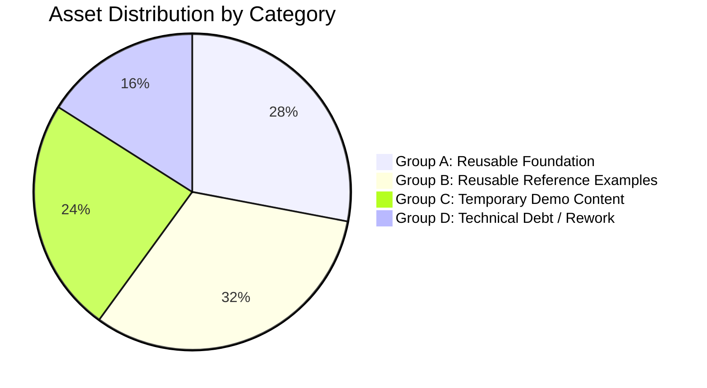

# ASSET AUDIT & RECLASSIFICATION MATRIX
**Document Identifier:** `docs/ASSET_AUDIT.md`  
**Role:** Principal Software Architect & Design Systems Auditor  
**Date:** November 2026  
**Scope:** Complete Codebase Inventory of `d:\Vibe_coding\Saas`
**Version:** 2.1.0

---

## 1. AUDIT METHODOLOGY & EVALUATION CRITERIA

Every file, module, and asset in the repository was audited against four strict design system criteria:
1. **Domain Agnosticism:** Is the component decoupled from specific industrial business domains (e.g. factory gloves, medical equipment, financial accounting)?
2. **Reusability & Portability:** Can another project or an autonomous AI agent import or copy this module without dragging in proprietary application state?
3. **Architectural Purity:** Does the module adhere to the separation of concerns (separating math/logic, visual tokens, chart options, and rendering)?
4. **Maintenance Value:** Does it contribute directly to the vision of a **Visual Design Intelligence Library**?

---

## 2. ASSET RECLASSIFICATION MATRIX

---

### GROUP A: REUSABLE FOUNDATION
*These assets form the framework-independent core of the library. They must be preserved, standardized, and made available as shared packages or copy-paste modules.*

| Asset Path | Component / Module | Why It Belongs to Group A |
| :--- | :--- | :--- |
| `tailwind.config.js` | **Warm & Neutral Design Tokens** | Defines the foundational palette (`warm`, `terracotta`, `coral`, `amberwarm`, `sage`), glass elevation shadows, and border radii. Highly reusable across projects. |
| `src/index.css` | **Glass & Surface Utility Classes** | Implements `.glass-card`, `.glass-sidebar`, `.glass-header`, specular top-edge highlights, and custom warm scrollbars with pure CSS. |
| `src/visualization/tokens/chartTokens.ts` | **Centralized Chart Tokens** | Maps categorical series scales, SPC limit colors, semantic status codes, typography sizes, and container padding into a single token contract. |
| `src/visualization/themes/enterpriseTheme.ts` | **ECharts Theme Definition** | Declarative ECharts theme registration establishing standard grid margins, subtle dashed gridlines, and frosted glass tooltip wrappers. |
| `src/visualization/playground/themes/playgroundThemes.ts` | **5 Enterprise Theme Systems** | Implements and registers *Light Enterprise*, *Dark Analytics*, *Warm Glass*, *Minimal Monochrome*, and *High Contrast (WCAG AAA)* with live palette swatches. |
| `src/visualization/core/EChartsWrapper.tsx` | **Universal Canvas Lifecycle Manager** | Hardware-accelerated canvas renderer, automatic debounced `ResizeObserver`, unmount memory disposal (`.dispose()`), error boundaries, and SSR fallback. Zero business logic. |
| `src/visualization/components/ChartContainer.tsx` | **Standard Chart Card Shell** | Reusable card container providing header title, BAN anchor badge, timeframe selector, PNG/CSV export triggers, and fullscreen toggle. |
| `src/visualization/utils/statisticalUtils.ts` | **Pure Statistical Math Engine** | Zero-dependency TypeScript math utilities calculating Mean, Sample Standard Deviation ($s$), Shewhart limits ($\pm 3\sigma$), Process Capability ($C_p, C_{pk}$), and Gaussian distribution curve coordinates. |
| `src/visualization/playground/adapters/playgroundOptionBuilder.ts` | **ECharts Option Builders & Suitability Engine** | Decoupled pure functions generating strongly-typed `EChartsOption` objects with automated methodological suitability validation (`checkChartSuitability`). |
| `src/components/common/ErrorBoundary.tsx` | **Global Component Error Boundary** | Prevents localized visualization or render crashes from breaking the host application tree. |
| `src/hooks/useAnimatedCounter.ts` | **Framer Motion Number Scroller** | Easing animation hook for smoothly counting up primary BAN KPI figures. |

---

### GROUP B: REUSABLE REFERENCE EXAMPLES
*These assets demonstrate canonical implementations of complex visualization archetypes. They serve as golden reference patterns for human engineers and AI coding agents.*

| Asset Path | Component / Archetype | Why It Belongs to Group B |
| :--- | :--- | :--- |
| `src/visualization/charts/quality/SpcControlChart.tsx` | **Shewhart Control Chart (I-MR)** | Canonical industrial implementation of statistical process control with auto-computed $\bar{X}$, $UCL$, $LCL$, and out-of-control point markers. |
| `src/visualization/charts/quality/ParetoChart8020.tsx` | **Pareto 80/20 Dual-Axis Chart** | Textbook implementation of Juran's Pareto triage: descending frequency bars + cumulative percentage line + 80% reference markLine. |
| `src/visualization/charts/quality/CapabilityHistogram.tsx` | **Process Capability (Cp/Cpk) Histogram** | Real-time binned histogram fitted with a continuous Gaussian probability density curve against $USL/LSL$ specification limits. |
| `src/visualization/charts/quality/DefectHeatmap.tsx` | **2D Spatial Defect Concentration Heatmap** | Matrix cross-tabulating categories against stations using continuous `visualMap` density encoding. |
| `src/visualization/charts/performance/KpiBulletChart.tsx` | **KPI Performance Bullet Chart** | Compact target vs actual representation within qualitative performance bands (Poor, Fair, Good); replaces misleading radial dials. |
| `src/visualization/charts/performance/WaterfallChart.tsx` | **Production & Capacity Loss Waterfall** | Step-wise deconstruction reconciling Gross Planned Capacity with Net Good Output using stacked floating bars. |
| `src/visualization/charts/operational/WorkflowSankey.tsx` | **Material & Yield Workflow Sankey** | Directed network ribbons enforcing visual volume conservation from raw material input through intermediate rework and scrap. |
| `src/visualization/charts/operational/OperationalTreemap.tsx` | **Hierarchical Defect Taxonomy Treemap** | High-density nested proportional tiles with interactive drill-down navigation. |
| `src/visualization/charts/advanced/QualityRadarChart.tsx` | **Multi-Axis Capability Radar** | Orthogonal benchmarking polygon comparing vendors or production lines across 5 to 7 normalized dimensions. |
| `src/visualization/charts/advanced/ComboTrendChart.tsx` | **Volume & Defect PPM Combo Trend** | Dual-axis correlation testing whether throughput volume push induces nonlinear scrap surges. |
| `src/visualization/playground/scenarios/scenarioDatasets.ts` | **10 Calibrated Industrial Datasets** | Statistically consistent synthetic datasets covering QA, KPI tracking, and operational monitoring with documented field schemas. |

---

### GROUP C: TEMPORARY DEMONSTRATION CONTENT
*These assets were built to simulate specific business use cases (such as a glove manufacturing plant or a SaaS marketing dashboard). They must NOT define the library's architecture and should be encapsulated into an "Examples & Showcase" section.*

| Asset Path | Module / Content | Why It Belongs to Group C |
| :--- | :--- | :--- |
| `src/components/factory/FactoryDashboardView.tsx` | **FactoryCore MES View** | Hardcoded to a specific latex glove manufacturing scenario (`Latex Tank 2`, `Batch B240522-001`, `Dipping 1`). High domain lock-in. |
| `src/components/factory/ProductionLineTable.tsx` | **Factory Line Status Table** | Specific table columns (`Line 1` to `Line 5`, `Pairs Output`, `OEE`) that belong to a demo showcase rather than core design library. |
| `src/components/factory/RecentBatchesTable.tsx` | **Batch Tracking Ledger** | Hardcoded batch records (`Latex Glove M/L`, `Inspection 2`). |
| `src/components/factory/TopRejectReasons.tsx` | **Reject Reason Bars** | Duplicates Pareto concepts with a basic progress bar layout locked to glove defect codes. |
| `src/components/factory/SystemHardwareStatus.tsx` | **Hardware Status Grid** | Domain-specific icons (`Weighing System`, `Label Printer`, `Vision System`). |
| `src/components/factory/FactoryAlerts.tsx` | **Factory Stoppage Alerts** | Domain-specific alert strings (`Palletizer not responding`). |
| `src/data/factoryMockData.ts` | **Hardcoded Factory Data** | Static mock data tied strictly to FactoryCore MES demo. |
| `src/components/dashboard/ExecutiveHero.tsx` | **SaaS Executive Hero Banner** | Marketing-style SaaS greeting (`"Welcome back, Alex"`, `"Platform ARR \$42.8M"`). |
| `src/components/dashboard/TransactionTable.tsx` | **SaaS Billing Transaction Table** | Stripe-like billing transaction mockup; unrelated to data visualization core. |
| `src/components/dashboard/ActivityTimeline.tsx` | **SaaS Activity Stream** | User account management activity stream (`"SSO Policy Updated"`). |
| `src/data/mockData.ts` | **Generic SaaS Mock Data** | Hardcoded SaaS billing, MRR, and transaction logs. |
| `src/components/layout/Sidebar.tsx` (Portions) | **Mock Menu Entries** | Sidebar links (`customers`, `billing`, `workspaces`, `ai-copilot`) that link to empty tabs or placeholder toasts. |

---

### GROUP D: TECHNICAL DEBT & REWORK
*These items represent duplication, coupling, or legacy implementations that must be refactored or consolidated during migration.*

| Asset Path | Issue / Deficiency | Required Action & Architectural Decision |
| :--- | :--- | :--- |
| **Dual Chart Registries** | `src/visualization/core/ChartRegistry.ts` (10 items) and `src/visualization/playground/registry/playgroundRegistry.ts` (12 items) duplicate chart metadata. | **Consolidate** into a single canonical `src/library/registry/chartRegistry.ts` with comprehensive metadata (Phase 2). |
| **Dual Exploration Views** | `VisualAnalyticsWorkbench.tsx` (static categorizer) vs `VisualAnalyticsPlayground.tsx` (interactive laboratory). | **Retire** `VisualAnalyticsWorkbench` and promote `VisualAnalyticsPlayground` as the canonical browser exploration interface. |
| **Mixed Charting Engines (Recharts)** | `RevenueAnalyticsChart.tsx` and `EfficiencyRadial.tsx` use `recharts` (SVG). | **ADR-01:** Isolate Recharts to `src/showcases/executive/` as an optional showcase artifact. Do NOT include Recharts in `src/library/`. |
| **Hardcoded Strings in Layout** | `Header.tsx` contains hardcoded mode switches (`"Factory MES"`, `"Executive SaaS"`) with bespoke conditional branches. | **Refactor** `Header.tsx` into a clean, library-driven documentation shell. |
| **Dispersion Limits Omission** | `SpcControlChart.tsx` calculates Individual limits but does not render the accompanying Moving Range ($MR$) chart required by ISO 7870-2. | **Enhance** the SPC reference chart to support dual-grid Individual + Moving Range visualization. |
| **Monolithic ECharts Imports** | Current code imports `* as echarts from 'echarts'`, resulting in a 1,089.1 KB raw / 358.6 KB gzip bundle. | **ADR-02:** Implement tiered tree-shaking in `src/library/core/`: Tier 1 Minimal (502.0 KB raw / 168.7 KB gzip), Tier 2 Industrial (742.2 KB raw / 244.6 KB gzip). |
