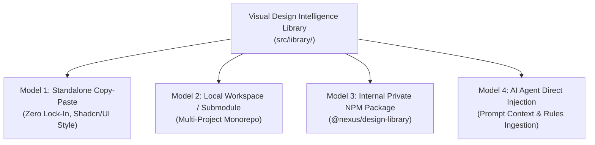

# CROSS-PROJECT REUSABILITY & CONSUMPTION STRATEGY
**Document Identifier:** `docs/CROSS_PROJECT_REUSE_STRATEGY.md`  
**Role:** Principal Software Architect & AI Developer Experience Engineer  
**Status:** Canonical Distribution & Integration Specification  
**Version:** 1.0.0

---

## 1. FOUR CONSUMPTION MODELS EVALUATION

To ensure maximum adoption across diverse enterprise projects (React, Next.js, Vue, or Python/FastAPI), the library supports four distinct consumption models:



### Comparison Matrix of Consumption Models

| Consumption Model | Primary Target Audience | Integration Complexity | Update Maintenance | External Tooling Required | Recommended Status |
| :--- | :--- | :--- | :--- | :--- | :---: |
| **Model 1: Copy-Paste (Shadcn-style)** | Single developers, bespoke client apps, rapid prototypes | **Zero** (Copy TS file + tokens) | Manual per file | None | **PRIMARY (Phase 1)** |
| **Model 2: Git Submodule / Worktree** | Multi-app internal projects (e.g., `Saas` + `IQC_nexus`) | **Low** (Linked repo folder) | `git pull` submodule | Git | **RECOMMENDED (Phase 2)** |
| **Model 3: Internal Private NPM** | Formal enterprise production teams with private Artifactory | **Medium** (Semantic versioning) | `pnpm update` | Private registry, CI/CD | **FUTURE (Phase 4)** |
| **Model 4: AI Agent Context (.ai)** | Autonomous AI coding agents (Antigravity, Claude Code) | **Zero** (Read markdown rules) | Continuous session sync | AI Assistant | **PRIMARY (Phase 1)** |

---

## 2. DEPENDENCY BOUNDARIES & MINIMUM INTEGRATION REQUIREMENTS

The library is designed with **zero transitive lock-in**. A target project only needs to install dependencies for the specific layers it consumes:

```
┌───────────────────────────────────────────────────────────────────────────────┐
│                      MINIMUM DEPENDENCY PROFILES                              │
├──────────────────────────┬────────────────────────────────────────────────────┤
│ CONSUMPTION PROFILE      │ REQUIRED DEPENDENCIES                              │
├──────────────────────────┼────────────────────────────────────────────────────┤
│ Profile 1: Tokens Only   │ ZERO dependencies. Pure CSS variables / JSON.      │
│ (Vanilla JS / Web)       │                                                    │
├──────────────────────────┼────────────────────────────────────────────────────┤
│ Profile 2: Pure Math     │ ZERO dependencies. Pure TypeScript. Works in Node, │
│ (SPC, Cpk, Nelson Rules) │ Bun, Browser, or Web Workers.                      │
├──────────────────────────┼────────────────────────────────────────────────────┤
│ Profile 3: Option Adapters│ `echarts` (^6.0.0). Pure functions returning       │
│ (Headless Visualization) │ `EChartsOption`. Zero React required.              │
├──────────────────────────┼────────────────────────────────────────────────────┤
│ Profile 4: Full React    │ `react` (^18 or ^19), `echarts` (^6.0.0),          │
│ UI & Canvas Archetypes   │ `framer-motion` (^11 or ^14), `lucide-react`.      │
└──────────────────────────┴────────────────────────────────────────────────────┘
```

---

## 3. INTEGRATION RECIPES FOR DIFFERENT TARGET STACKS

### Recipe A: React + Vite / Tailwind Project
1. **Copy Tokens:** Copy `src/library/tokens/colorTokens.ts` and merge into `tailwind.config.js`.
2. **Copy Core Wrapper:** Copy `src/library/core/EChartsWrapper.tsx` and `echartsCore.ts`.
3. **Install Peer Dependencies:**
   ```bash
   pnpm add echarts framer-motion lucide-react clsx tailwind-merge
   ```
4. **Import Desired Archetype:**
   ```tsx
   import { SpcControlChart } from '@/library/archetypes/SpcControlChart';
   
   export function QualityView() {
     return <SpcControlChart data={sensorSamples} usl={25.5} lsl={24.5} />;
   }
   ```

### Recipe B: Next.js 16 (App Router) Project (e.g., `IQC_nexus`)
1. **Client Boundary:** Since ECharts requires browser canvas DOM, wrap `EChartsWrapper` with `'use client';`.
2. **SSR Safety:** `EChartsWrapper.tsx` already features SSR safety checks (`typeof window !== 'undefined'`) and defensive null checks on DOM references.
3. **Zero Hydration Mismatch:** The chart canvas initializes inside a `useEffect`, ensuring zero mismatch with server-rendered HTML.

### Recipe C: Vanilla JavaScript / HTML + ECharts CDN
1. **Export Raw Option:** In Node.js or backend Python, invoke the pure adapter:
   ```javascript
   import { buildSpcOption } from './adapters/spcAdapter.js';
   const option = buildSpcOption({ samples, ucl, lcl, mean, theme: 'light-enterprise' });
   ```
2. **Render in Browser:**
   ```javascript
   const chart = echarts.init(document.getElementById('chart-container'), 'light-enterprise');
   chart.setOption(option);
   ```

### Recipe D: Python / FastAPI + Jinja2 (MES / SCADA Web)
1. **Server-Side Math:** FastAPI computes SPC control limits or serves raw telemetry via REST `/api/v1/telemetry/spc`.
2. **Client Script:** The HTML page imports `echarts.min.js` via local static file and feeds the JSON option directly to `chart.setOption(data)`.

---

## 4. CODE GOVERNANCE & VERSIONING PROTOCOL

When independent projects copy or link modules from this library:
1. **No Breaking Interface Changes:** Function signatures in `src/library/math/` and `src/library/adapters/` follow strict semantic backward compatibility.
2. **Mandatory Canonical Headers:** Every reusable file in `src/library/` starts with a standardized header indicating its version, dependencies, and pure functional contract:
   ```typescript
   /**
    * @library Visual Design Intelligence Library 2026
    * @module src/library/math/statisticalUtils.ts
    * @version 2.0.0
    * @dependencies None (Pure TypeScript)
    * @standards ISO 7870-2 / AIAG SPC 2nd Ed
    */
   ```
