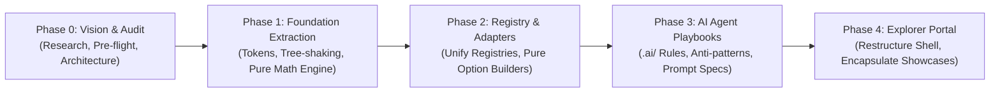

# IMPLEMENTATION ROADMAP & RESTRUCTURING PLAN
**Document Identifier:** `docs/IMPLEMENTATION_ROADMAP.md`  
**Role:** Principal Software Architect & Release Coordinator  
**Status:** Strategic Transition Plan & Migration Gateways  
**Version:** 2.1.0

---

## 1. PHASED MIGRATION TIMELINE

The transition of the repository from a dual-purpose dashboard into a standalone **Visual Design Intelligence Library** is structured into five non-destructive, verified phases:

---

### PHASE 0: VISION, AUDIT & PRE-FLIGHT (CURRENT PHASE — COMPLETED)
*Objective: Establish framework-independent vision, audit existing assets, conduct empirical bundle benchmarks, and formulate verified pre-flight plans.*
- [x] Complete asset audit of all existing files into Groups A, B, C, D ([`docs/ASSET_AUDIT.md`](file:///d:/Vibe_coding/Saas/docs/ASSET_AUDIT.md)).
- [x] Define canonical product vision and dual-audience charter ([`docs/PRODUCT_VISION.md`](file:///d:/Vibe_coding/Saas/docs/PRODUCT_VISION.md)).
- [x] Specify the 6 formal architectural layers (A to F) and separation of concerns ([`docs/PRODUCT_ARCHITECTURE.md`](file:///d:/Vibe_coding/Saas/docs/PRODUCT_ARCHITECTURE.md)).
- [x] Conduct empirical Vite/Rollup tree-shaking benchmarks ([`docs/TECHNICAL_DECISIONS.md`](file:///d:/Vibe_coding/Saas/docs/TECHNICAL_DECISIONS.md)):
  - *Monolithic ECharts:* 1,089.1 KB raw / 358.6 KB gzip.
  - *Tier 1 Minimal (Line + Bar + Canvas):* 502.0 KB raw / 168.7 KB gzip.
  - *Tier 2 Industrial 10-Archetypes:* 742.2 KB raw / 244.6 KB gzip.
- [x] Formulate ADR-01 (Recharts Isolation Strategy), ADR-02 (Tiered Tree-Shaking), ADR-03 (Domain Independence), ADR-04 (Pure Math Engine).
- [x] Formulate Cross-Project Reuse Strategy ([`docs/CROSS_PROJECT_REUSE_STRATEGY.md`](file:///d:/Vibe_coding/Saas/docs/CROSS_PROJECT_REUSE_STRATEGY.md)) covering React, Vanilla JS, and FastAPI/Python.
- [x] Deliver detailed Phase 1 Pre-Flight Module Extraction Specifications ([`docs/PHASE_1_PREFLIGHT.md`](file:///d:/Vibe_coding/Saas/docs/PHASE_1_PREFLIGHT.md)).
- [x] **MANDATORY HOLD:** Await explicit Leader authorization before any Phase 1 code changes.

---

### PHASE 1A: CORE FOUNDATION EXTRACTION (COMPLETED)
*Objective: Extract design tokens, themes, pure mathematical engines, and visualization contract into an isolated, copy-paste-ready `src/library/` directory with zero regression on existing views.*
- [x] **Module 1: Design Tokens & Themes (`src/library/tokens/`, `src/library/themes/`):**
  - Universal tokens (colors, typography, spacing, glass elevation, semantic status) exported as pure TypeScript.
  - The 5 canonical themes registered as pure data contracts (*Light Enterprise, Dark Analytics, Warm Glass, Minimal Monochrome, High Contrast*).
  - Standalone ECharts theme configuration generator (`createEChartsThemeConfig`).
  - Module documentation in `src/library/tokens/README.md` and `src/library/themes/README.md`.
- [x] **Module 2: Pure Statistical Math Engine (`src/library/math/`):**
  - Zero-dependency functions: Mean, Sample StdDev ($n-1$ Bessel correction), Median, Shewhart $\pm 3\sigma$ limits, Process Capability ($C_p, C_{pk}, C_{pu}, C_{pl}$), Gaussian normal distribution curve, and Pareto 80/20 triage.
  - Automated Nelson Rules 1 through 4 evaluator with boundary protections.
  - 23 unit tests automated via `node --test` (`pnpm test`): 100% passing.
  - Module documentation in `src/library/math/README.md`.
- [x] **Visualization JSON Contract (`src/library/contracts/`):**
  - Platform-agnostic `VisualizationSpec` JSON contract defining data structures for frontend renderers and backend Python/FastAPI emitters.
  - Module documentation in `src/library/contracts/README.md`.
- [x] **Backward-Compatibility Facade:**
  - `src/visualization/utils/statisticalUtils.ts` converted into a thin adapter delegating to `src/library/math/` with zero breaking changes for existing components.
- [x] **Quality Gates Passed:**
  - `pnpm test` (23/23 pass in 110ms), `tsc -b && vite build` (pass in 1.16s), `oxlint` (0 warnings, 0 errors), active HMR verified on `http://localhost:5173/`.
  - Detailed report delivered in [`docs/PHASE_1A_IMPLEMENTATION_REPORT.md`](file:///d:/Vibe_coding/Saas/docs/PHASE_1A_IMPLEMENTATION_REPORT.md).

---

### PHASE 1B: ECHARTS CORE, TREE-SHAKING & ADAPTERS (IN PROGRESS)
- [x] **Phase 1B.1 — ECharts Modular Core & Tree-Shaking (`src/library/core/` - COMPLETED):**
  - Implemented Tier 2 Industrial selective tree-shaking in `echartsCore.ts` (9 charts, 10 components, 2 renderers, 5 themes pre-registered).
  - Measured build reduction: **768.7 KB raw / 255.0 KB gzip** (giảm 320.4 KB raw và 103.6 KB gzip so với monolithic ECharts).
  - Implemented universal `EChartsWrapper.tsx` (React 19 `forwardRef`, RAF-throttled debounced ResizeObserver, strict `.dispose()`, error boundary).
  - Backward-compatibility facade in `src/visualization/core/EChartsWrapper.tsx`.
  - 30 unit tests pass (100%), build pass in 1.34s, oxlint 0 warnings/0 errors.
  - Detailed report in [`docs/PHASE_1B_1_VERIFICATION_REPORT.md`](file:///d:/Vibe_coding/Saas/docs/PHASE_1B_1_VERIFICATION_REPORT.md).
- [ ] **Phase 1B.2 — Decoupled Option Builders & Adapters (`src/library/adapters/` - PENDING APPROVAL):**
  - Extract pure adapter functions (`spcAdapter`, `paretoAdapter`, `capabilityAdapter`, `heatmapAdapter`, etc.).
  - Ensure adapters accept generic interfaces (`value`, `target`, `upperLimit`, `lowerLimit`) with zero React hooks.
- [ ] **Phase 1B.3 — UI Shell Primitives (`src/library/ui/` - PENDING APPROVAL):**
  - Extract reusable presentation shells (`ChartContainer.tsx`, `ExecutiveKpiCard.tsx`, `ErrorBoundary.tsx`).

---

### PHASE 2: REGISTRY CONSOLIDATION & ADAPTER UNIFICATION
*Objective: Unify duplicated chart registries and decouple all chart option builders into pure functions.*
- [ ] **Single Canonical Registry (`src/library/registry/chartRegistry.ts`):**
  - Merge the legacy 10-item `src/visualization/core/ChartRegistry.ts` with the 12-item `src/visualization/playground/registry/playgroundRegistry.ts`.
  - Provide rich metadata: ID, Name, Category, Description, Business Use Case, Required Data Contract, Complexity, Strengths, Limitations, and Default Dataset ID.
- [ ] **Methodological Suitability Engine (`src/library/registry/suitabilityEngine.ts`):**
  - Provide automated validation flagging mismatched charts with specific remediation advice.
- [ ] **Universal Scenario Benchmarks (`src/library/scenarios/`):**
  - Move calibrated industrial datasets into library reference scenarios.

---

### PHASE 3: AI DEVELOPER EXPERIENCE & DESIGN PLAYBOOKS
*Objective: Build machine-readable rules and prompt templates for autonomous AI coding agents.*
- [ ] **Create `.ai/rules/` Directory:**
  - `visual-design-tokens.md`: Mandatory color, font, and shadow rules.
  - `chart-selection-decision-tree.md`: Question-to-chart decision flowchart.
  - `statistical-integrity-spc.md`: Six Sigma mathematical formulas ($UCL/LCL$ vs $USL/LSL$, within-subgroup $\sigma$ vs total $s$).
  - `anti-patterns.md`: Explicitly prohibited AI visual flaws (banning 3D bars, pie charts $>4$ slices, glowing borders).
- [ ] **Cross-Framework Implementation Recipes (`docs/recipes/`):**
  - Recipe 1: Building a Six Sigma Quality Dashboard with ECharts & Tailwind (React / Next.js).
  - Recipe 2: Building an Operational Monitoring Board for Plant Floor Terminals (Vanilla JS + ECharts CDN).
  - Recipe 3: Building a Python / FastAPI Server-Side Rendered Analytics View (Jinja2 + ECharts JSON).

---

### PHASE 4: EXPLORER PORTAL RESTRUCTURING & SHOWCASE ENCAPSULATION
*Objective: Refactor the browser interface to present the library professionally while preserving legacy demo views as reference showcases.*
- [ ] **Encapsulate Showcase Views (`src/showcases/`):**
  - Move `FactoryDashboardView.tsx` into `src/showcases/factory/` as a reference plant-floor implementation.
  - Move `ExecutiveHero.tsx`, `TransactionTable.tsx`, and `ActivityTimeline.tsx` into `src/showcases/executive/` as reference SaaS implementations.
  - Isolate Recharts to `src/showcases/executive/` without mandating it in the core library.
- [ ] **Modernize Navigation Shell (`Sidebar.tsx` & `Header.tsx`):**
  - Re-align navigation items to mirror the 5 sections in [`docs/INFORMATION_ARCHITECTURE.md`](file:///d:/Vibe_coding/Saas/docs/INFORMATION_ARCHITECTURE.md):
    1. *Playground & Experimentation Laboratory* (Default landing view)
    2. *Design System & Visual Tokens*
    3. *Chart Archetype Catalog*
    4. *AI Agent Playbooks & Recipes*
    5. *Reference Showcases* (MES & SaaS)
- [ ] **Retire Redundant Code:**
  - Safely remove unused `VisualAnalyticsWorkbench.tsx` once replaced by the unified playground.

---

## 2. MIGRATION SAFETY & ROLLBACK PROTOCOL (ZERO BREAKING CHANGES)

To ensure that the running development server (`http://localhost:5173/`) and existing demos never break:
1. **Parallel Extraction Before Deletion:** Never delete a source file before its extracted equivalent is compiled, tested, and imported via alias.
2. **Backward-Compatibility Facade:** Legacy paths re-export extracted modules during Phase 1 (`export * from '@/library/tokens'`).
3. **Automated Quality Gates at Every Step:**
   - Run `pnpm run build` (`tsc -b && vite build`) to guarantee 100% type safety.
   - Run `npx oxlint` to ensure 0 lint warnings and 0 errors.
   - Verify active HMR on `http://localhost:5173/`.
4. **Instant Rollback:** If any step fails typecheck or HMR, git checkout reverts that step's change cleanly without cross-file contamination.
