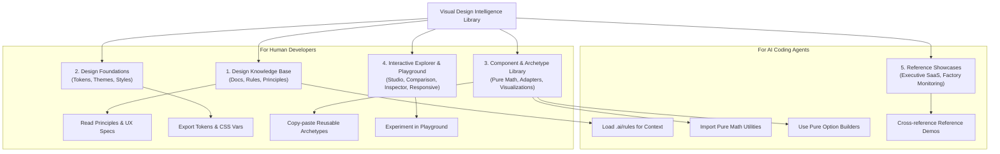

# INFORMATION ARCHITECTURE & REPOSITORY TAXONOMY
**Document Identifier:** `docs/INFORMATION_ARCHITECTURE.md`  
**Role:** Principal Software Architect & Design Systems Architect  
**Status:** Information Architecture & Directory Blueprint  
**Version:** 2.0.0

---

## 1. INFORMATION TAXONOMY & AUDIENCE PATHWAYS

The library organizes its documentation, tokens, components, and interactive tools into clear pathways for both human engineers and autonomous AI agents:



---

## 2. PROPOSED REPOSITORY DIRECTORY STRUCTURE

To cleanly separate reusable library code from demo mockups and the browser portal, the repository will be refactored into the following modular hierarchy:

```
saas/ (Repository Root)
├── .ai/                                    # AI Coding Agent Instructions & Guardrails
│   ├── rules/
│   │   ├── visual-design-tokens.md         # Mandatory color, font, and shadow rules
│   │   ├── chart-selection-decision-tree.md# Decision tree mapping questions to charts
│   │   ├── statistical-integrity-spc.md    # Six Sigma formulas (I-MR, X-bar, Cpk)
│   │   └── anti-patterns.md                # Prohibited AI Slop designs
│   └── playbooks/
│       ├── build-quality-dashboard.md      # Step-by-step agent recipe
│       └── build-kpi-monitoring-board.md   # Step-by-step agent recipe
│
├── docs/                                   # Framework-Agnostic Design Documentation
│   ├── PRODUCT_VISION.md                   # Vision, mission, and scope
│   ├── PRODUCT_ARCHITECTURE.md             # 8 domains and separation of concerns
│   ├── ASSET_AUDIT.md                      # Audit of existing assets (Groups A-D)
│   ├── INFORMATION_ARCHITECTURE.md         # This document
│   ├── IMPLEMENTATION_ROADMAP.md           # Phased migration and delivery plan
│   └── visual-analytics-research/          # 7 Deep Research Papers (ECharts, SPC, UX)
│       ├── 01_RESEARCH_SUMMARY.md
│       ├── 02_CHART_CATALOG.md
│       ├── 03_CHART_SELECTION_GUIDE.md
│       ├── 04_INTERACTION_DESIGN_GUIDELINES.md
│       ├── 05_DASHBOARD_UX_PRINCIPLES.md
│       ├── 06_GRAPHIC_SYSTEM_ARCHITECTURE.md
│       └── 07_IMPLEMENTATION_ROADMAP.md
│
├── src/                                    # Implementation Source Code
│   ├── library/                            # THE REUSABLE CORE (Domain-Agnostic)
│   │   ├── tokens/                         # Design Token Definitions
│   │   │   ├── colorTokens.ts              # Palettes (Warm, Slate, Emerald, Terracotta)
│   │   │   ├── typographyTokens.ts         # Typography scales and tabular numbers
│   │   │   ├── shadowTokens.ts             # Specular glass and high-contrast shadows
│   │   │   └── index.ts
│   │   ├── math/                           # Pure Statistical & Analytical Math Engine
│   │   │   ├── statisticalUtils.ts         # Mean, StDev, Shewhart UCL/LCL, Cpk, Gaussian
│   │   │   ├── nelsonRules.ts              # Automated Nelson Rules 1-4 violation evaluator
│   │   │   └── paretoCalculator.ts         # 80/20 sorting and COPQ cost weighting
│   │   ├── core/                           # Universal ECharts Infrastructure
│   │   │   ├── echartsCore.ts              # Tree-shaken modular ECharts bundle (<180KB)
│   │   │   ├── EChartsWrapper.tsx          # Memory-safe canvas lifecycle manager
│   │   │   ├── ChartContainer.tsx          # Standard card shell with header, BAN & export
│   │   │   └── ErrorBoundary.tsx           # Visual error fallback boundary
│   │   ├── themes/                         # Registered ECharts Themes
│   │   │   ├── lightEnterprise.ts          # Daytime business theme
│   │   │   ├── darkAnalytics.ts            # High-contrast 24/7 dark NOC theme
│   │   │   ├── warmGlass.ts                # Warm neutral glassmorphism theme
│   │   │   ├── minimalMonochrome.ts        # Restrained zinc theme
│   │   │   ├── highContrast.ts             # WCAG AAA accessible theme
│   │   │   └── index.ts                    # Auto-registration registry
│   │   ├── adapters/                       # Pure ECharts Option Builders
│   │   │   ├── spcAdapter.ts               # Raw telemetry -> SPC option
│   │   │   ├── paretoAdapter.ts            # Defect records -> Pareto option
│   │   │   ├── capabilityAdapter.ts        # Sample array -> Histogram + Gaussian option
│   │   │   ├── heatmapAdapter.ts           # 2D matrix -> Heatmap option
│   │   │   ├── bulletAdapter.ts            # Target vs Actual -> Bullet option
│   │   │   ├── waterfallAdapter.ts         # Loss walk -> Waterfall option
│   │   │   ├── sankeyAdapter.ts            # Routing links -> Sankey option
│   │   │   ├── treemapAdapter.ts           # Taxonomy -> Treemap option
│   │   │   ├── radarAdapter.ts             # Orthogonal metrics -> Radar option
│   │   │   └── comboTrendAdapter.ts        # Throughput & PPM -> Dual-axis option
│   │   ├── registry/                       # Centralized Chart Registry
│   │   │   ├── chartRegistry.ts            # Canonical registry of all 12 archetypes
│   │   │   └── suitabilityEngine.ts        # Validates chart suitability for data types
│   │   └── archetypes/                     # Standalone Pre-Wired Reference Components
│   │       ├── SpcControlChart.tsx
│   │       ├── ParetoChart8020.tsx
│   │       ├── CapabilityHistogram.tsx
│   │       ├── DefectHeatmap.tsx
│   │       ├── KpiBulletChart.tsx
│   │       ├── WaterfallChart.tsx
│   │       ├── WorkflowSankey.tsx
│   │       ├── OperationalTreemap.tsx
│   │       ├── QualityRadarChart.tsx
│   │       └── ComboTrendChart.tsx
│   │
│   ├── playground/                         # BROWSER EXPLORATION WORKBENCH
│   │   ├── components/
│   │   │   ├── ChartGallery.tsx            # Searchable catalog & list/grid views
│   │   │   ├── ScenarioSelector.tsx        # QA, KPI, and Ops dataset switcher
│   │   │   ├── ThemeSelector.tsx           # 5-theme switcher with palette swatches
│   │   │   ├── ChartComparison.tsx         # Side-by-side multi-chart comparison
│   │   │   ├── InteractivePreview.tsx      # Live canvas with zoom, fullscreen & exports
│   │   │   ├── ConfigInspector.tsx         # Live JSON editor & copy-to-clipboard
│   │   │   └── ResponsivePreview.tsx       # 4-viewport device frame simulator
│   │   ├── datasets/                       # 10 Calibrated Synthetic Datasets
│   │   │   └── scenarioDatasets.ts
│   │   └── VisualAnalyticsPlayground.tsx   # Master playground view
│   │
│   ├── showcases/                          # DEMONSTRATION & INTEGRATION SHOWCASES
│   │   ├── factory/                        # Reference Factory Monitoring View (MES)
│   │   │   └── FactoryDashboardView.tsx
│   │   └── executive/                      # Reference Executive Pulse View (SaaS)
│   │       └── ExecutiveDashboardView.tsx
│   │
│   ├── components/layout/                  # Portal Shell & Navigation
│   │   ├── Header.tsx                      # Explorer top bar
│   │   └── Sidebar.tsx                     # Library category navigation
│   │
│   ├── App.tsx                             # Explorer routing root
│   ├── main.tsx
│   └── index.css                           # Glass tokens & global base styles
│
├── tailwind.config.js                      # Tailwind theme extension
├── vite.config.ts                          # Vite build config
├── tsconfig.json
└── package.json
```

---

## 3. EXPLORER PORTAL NAVIGATION ARCHITECTURE

Inside the browser-based library explorer, the navigation is restructured to reflect the library's true identity:

```
NEXUS VISUAL DESIGN INTELLIGENCE LIBRARY (Explorer Navigation)
├── 🔬 PLAYGROUND & LABS (Default View)
│   ├── Experiment Studio           # Test any archetype against datasets, themes, and viewports
│   ├── Side-by-Side Comparison     # Compare 2-4 charts on identical data with suitability checks
│   └── Archetype Gallery           # Searchable catalog of all 12 registered visualization types
│
├── 📚 DESIGN SYSTEM & FOUNDATIONS
│   ├── Visual Tokens & Palettes    # Inspect Warm Glass, Slate, Monochrome, and High-Contrast tokens
│   ├── Layout & Bento Grid         # Inverted pyramid layout principles and responsive grid rules
│   └── Interaction & Motion Physics# Observable Plot crosshairs, click-to-pin, and Framer spring physics
│
├── 📊 VISUALIZATION ARCHETYPES
│   ├── Quality & SPC Engine        # Shewhart I-MR, Pareto 80/20, Capability Cp/Cpk, Defect Heatmap
│   ├── Performance & Target Walk   # Bullet Charts, Waterfall Reconciliation, Comparative Bars
│   └── Operational Flow & Multi-D  # Workflow Sankey, Taxonomy Treemap, Capability Radar, Combo Trend
│
├── 🤖 AI AGENT PLAYBOOKS
│   ├── Prompt Blueprints           # Copyable agent prompts for generating clean dashboards
│   ├── Anti-Pattern Catalog        # Visual and statistical anti-patterns prohibited by the system
│   └── Implementation Recipes      # Framework-specific implementation guides (React, Next.js, HTML)
│
└── 🖥️ REFERENCE SHOWCASES (Demos)
    ├── Operational MES Board       # High-contrast shop-floor monitoring board implementation
    └── Executive SaaS Pulse        # Warm glassmorphism executive intelligence dashboard
```

---

## 4. DOMAIN-INDEPENDENCE CONTRACT

To ensure the library never becomes an accidental business silo:
1. **Generic Parameter Names:** Props and data interfaces must use generic mathematical terms (`value`, `target`, `timestamp`, `category`, `upperLimit`, `lowerLimit`, `source`, `target`), never domain-specific acronyms (`glovePairs`, `tank2Viscosity`, `operatorBadgeId`).
2. **Pluggable Data Providers:** Any reference chart must accept an arbitrary array of values without requiring specialized database schemas.
3. **Decoupled Labels:** Text labels for units and titles must be configurable via props (e.g. `unit: string = 'units'`), defaulting to universal units rather than hardcoded factory terms.
