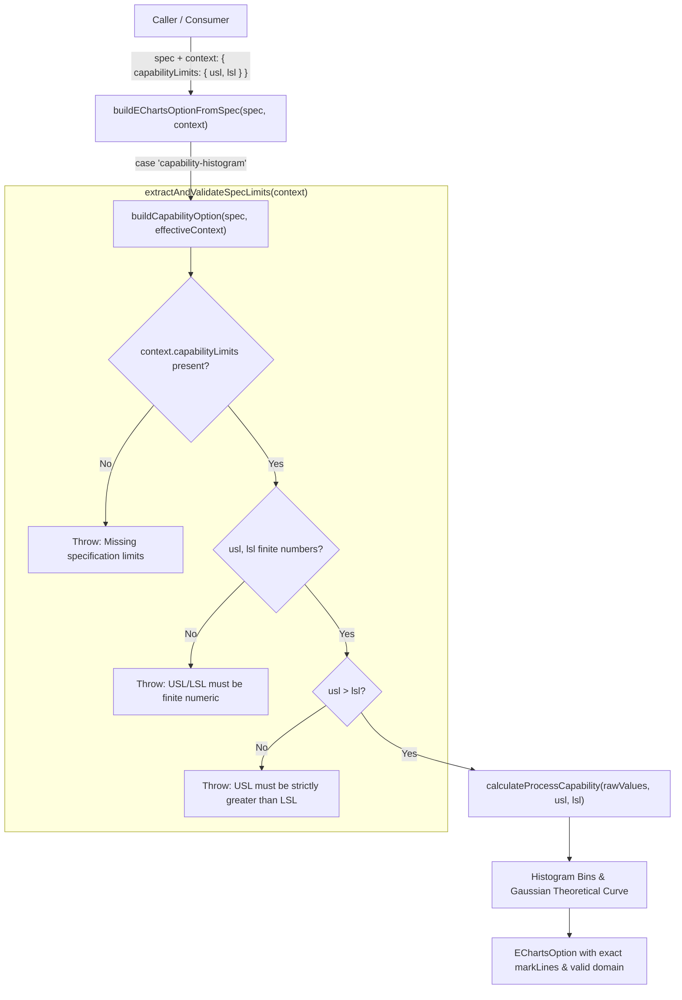

# PHASE 1B.2.3 — CAPABILITY SPECIFICATION SAFETY REMEDIATION REPORT

**Document Version:** 1.0.0  
**Date:** 2026-11-12  
**Role:** Senior TypeScript Engineer & Quality Engineering Visualization Architect  
**Task:** AGY TASK 02.3 — Capability Specification Safety Remediation  
**Status:** COMPLETE (Remediation Implemented, Verified, Quality Gates Passed)

---

## A. ROOT CAUSE AND REMEDIATION

### A.1 Original Defect
In Task 02.2 audit, `src/library/builders/families/capabilityBuilder.ts` lines 27-29 was discovered to contain:
```typescript
// Default rational spec limits if not in summary
const usl = 10.5;
const lsl = 9.5;
const capability = calculateProcessCapability(rawValues, usl, lsl);
```
**Impact:**
Any `VisualizationSpec` dispatched through `buildEChartsOptionFromSpec` or `buildCapabilityOption` without external overrides was subjected to silent synthetic limits ($USL=10.5, LSL=9.5$). For industrial processes measuring nominal dimensions (e.g. 100mm) or tight precision parts, this produced completely misleading capability assessments ($Cp, Cpk$) and skewed histogram bins without issuing warnings or errors.

### A.2 Exact Source Files Modified
1. `src/library/builders/families/capabilityBuilder.ts`:
   - Removed the unconditional fallback constants `usl = 10.5; lsl = 9.5;`.
   - Added robust runtime validator function `extractAndValidateSpecLimits(context)`.
   - Guaranteed that calculations only proceed with validated, finite numbers where `usl > lsl`.
2. `src/library/builders/builder.types.ts`:
   - Extended `BuilderContext` with optional `capabilityLimits?: { usl: number; lsl: number }`.
   - Preserved 100% of the established `VisualizationSpec` contract in `visualizationContract.ts` without modification.
3. `src/library/builders/README.md`:
   - Added Section 3.3 documenting required usage of `BuilderContext.capabilityLimits`.
4. `src/library/builders/__tests__/chartBuilders.test.ts`:
   - Updated the basic builder test to provide explicit limits.
5. `src/library/builders/__tests__/capabilityRemediation.test.ts` *(New Test Suite)*:
   - 14 automated runtime tests covering Case A, Case B, Case C, 10 negative validation cases (Case D), and adapter propagation (Case E).

### A.3 Execution Path & Validation Architecture


---

## B. NUMERICAL VERIFICATION

Both audit benchmark cases were executed and validated against direct Phase 1A pure math calculations:

### Case A — 100mm Mechanical Component
- **Input Data:** `[100.1, 100.2, 99.8, 100.0, 100.3, 99.9]`
- **Supplied Limits:** $USL = 101.0$, $LSL = 99.0$
- **Direct Math Result:** $Cp = 1.78$, $Cpk = 1.69$, $isCapable = true$
- **Builder Verification:**
  - $USL$ markLine formatter: `'USL: 101'`
  - $LSL$ markLine formatter: `'LSL: 99'`
  - 12 Histogram bins correctly span the actual range: `99.00 - 99.17` through `100.83 - 101.00`.
  - Theoretical Gaussian curve aligns with mean ($100.05$) and stdDev ($0.187$).

### Case B — 10mm Precision Component (Tight Tolerance)
- **Input Data:** `[10.1, 10.2, 9.9, 10.0, 10.3, 9.8]`
- **Supplied Limits:** $USL = 10.15$, $LSL = 9.85$
- **Direct Math Result:** $Cp = 0.27$, $Cpk = 0.18$, $isCapable = false$
- **Builder Verification:**
  - $USL$ markLine formatter: `'USL: 10.15'`
  - $LSL$ markLine formatter: `'LSL: 9.85'`
  - Correctly reflects an incapable process without any synthetic distortion.

---

## C. NEGATIVE TESTING & RUNTIME ERROR TABLE

The runtime validator strictly tests and rejects all invalid inputs:

| # | Input Condition | Runtime Behavior | Actual Error Message | Test Status |
|---|---|---|---|:---:|
| 1 | No context / no limits | Throws Error | `CapabilityHistogram requires explicit specification limits (capabilityLimits with finite USL and LSL) in BuilderContext.` | **PASS** |
| 2 | Empty context `{}` | Throws Error | `CapabilityHistogram requires explicit specification limits (capabilityLimits with finite USL and LSL) in BuilderContext.` | **PASS** |
| 3 | `usl: undefined` | Throws Error | `CapabilityHistogram requires explicit USL (Upper Specification Limit).` | **PASS** |
| 4 | `lsl: undefined` | Throws Error | `CapabilityHistogram requires explicit LSL (Lower Specification Limit).` | **PASS** |
| 5 | `usl: null` | Throws Error | `CapabilityHistogram requires explicit USL (Upper Specification Limit).` | **PASS** |
| 6 | `lsl: null` | Throws Error | `CapabilityHistogram requires explicit LSL (Lower Specification Limit).` | **PASS** |
| 7 | `usl: NaN` | Throws Error | `CapabilityHistogram requires finite numeric USL, received: NaN` | **PASS** |
| 8 | `lsl: NaN` | Throws Error | `CapabilityHistogram requires finite numeric LSL, received: NaN` | **PASS** |
| 9 | `usl: Infinity` | Throws Error | `CapabilityHistogram requires finite numeric USL, received: Infinity` | **PASS** |
| 10 | `lsl: -Infinity` | Throws Error | `CapabilityHistogram requires finite numeric LSL, received: -Infinity` | **PASS** |
| 11 | `usl = lsl` ($10 = 10$) | Throws Error | `CapabilityHistogram requires USL > LSL. Received USL=10, LSL=10.` | **PASS** |
| 12 | `usl < lsl` ($9 < 11$) | Throws Error | `CapabilityHistogram requires USL > LSL. Received USL=9, LSL=11.` | **PASS** |

---

## D. ADAPTER PROPAGATION

Verification in `src/library/builders/__tests__/capabilityRemediation.test.ts` (Case E):
1. Calling `buildEChartsOptionFromSpec(spec)` without `capabilityLimits` throws runtime error immediately.
2. Calling `buildEChartsOptionFromSpec(spec, { capabilityLimits: { usl: 101, lsl: 99 } })`:
   - `specAdapter.ts` merges context: `effectiveContext = { ...context, theme }`.
   - `buildCapabilityOption(spec, effectiveContext)` receives `effectiveContext.capabilityLimits`.
   - Limits pass validation and are transferred directly to `calculateProcessCapability()`.
   - Zero context or precision is lost between layers.

---

## E. TWELVE ARCHETYPE AUDIT & SEMANTIC SUPPORT

Comprehensive review of all 12 archetypes declared in `VisualizationSpec`:

| # | Archetype Literal | Dispatch Branch in `specAdapter.ts` | Target Builder Implementation | Intended Semantic Support | Semantic Status |
|:---:|:---|:---|:---|:---|:---:|
| 1 | `spc-control` | `case 'spc-control'` | `families/spcBuilder.ts` | Shewhart control chart with UCL, CL, LCL, Nelson violation dots | **Genuinely Supported** |
| 2 | `pareto-8020` | `case 'pareto-8020'` | `families/paretoBuilder.ts` | Defect count bars + cumulative % line + 80% markLine | **Genuinely Supported** |
| 3 | `capability-histogram` | `case 'capability-histogram'` | `families/capabilityBuilder.ts` | 12-bin sample frequency + normal Gaussian curve + verified USL/LSL | **Genuinely Supported (Remediated)** |
| 4 | `defect-heatmap` | `case 'defect-heatmap'` | `families/heatmapBuilder.ts` | 2D defect density matrix with continuous visualMap gradient | **Genuinely Supported** |
| 5 | `operational-treemap` | `case 'operational-treemap'` | `families/hierarchicalBuilder.ts` | Hierarchical defect/loss distribution with saturation levels | **Genuinely Supported** |
| 6 | `workflow-sankey` | `case 'workflow-sankey'` | `families/relationalBuilder.ts` | Directed station flow with gradient links and node tooltips | **Genuinely Supported** |
| 7 | `quality-radar` | `case 'quality-radar'` | `families/radarBuilder.ts` | Multi-dimensional quality metrics on closed polygon axes | **Genuinely Supported** |
| 8 | `combo-trend` | `case 'combo-trend'` | `families/cartesianBuilder.ts` | Volume bars + rate line on category axis | **Genuinely Supported** |
| 9 | `continuous-trend` | `case 'continuous-trend'` | `families/cartesianBuilder.ts` | Time-series line chart with optional smooth curve | **Genuinely Supported** |
| 10 | `kpi-bullet` | `case 'kpi-bullet'` | `families/cartesianBuilder.ts` | Bar series with target/threshold markLines & markAreas | **Supported via Cartesian Marks** |
| 11 | `waterfall` | `case 'waterfall'` | `families/cartesianBuilder.ts` | Production loss walk (Gross to Net) | **Supported via Cartesian Series** |
| 12 | `horizon-area` | `case 'horizon-area'` | `families/cartesianBuilder.ts` | Layered area charts for high-density multi-sensor trends | **Supported via Cartesian Area** |

*Note on Cartesian Grouping (8–12):*  
Archetypes 8–12 share Cartesian category/value topology. In Phase 1C / future expansion, specialized builders (e.g. dedicated waterfall stacking) can be separated without breaking the contract.

---

## F. QUALITY GATES RECORD

| Check | Command | Result | Details |
|---|---|:---:|---|
| **Capability Remediation Tests** | `node --test src/library/builders/__tests__/capabilityRemediation.test.ts` | **PASS** | 14/14 tests pass (5.16ms) |
| **All Builder Tests** | `node --test src/library/builders/__tests__/*.test.ts` | **PASS** | 32/32 tests pass (23.4ms) |
| **Full Project Test Suite** | `pnpm test` | **PASS** | 84/84 tests pass across 20 suites (912ms) |
| **TypeScript Static Check** | `pnpm exec tsc -b` | **PASS** | Zero diagnostics, clean exit |
| **Vite Production Build** | `pnpm exec vite build` | **PASS** | 3,537 modules transformed (1.20s), zero bundle regression |
| **Oxlint Linter** | `npx oxlint` | **PASS** | 0 warnings, 0 errors across 104 files |
| **Zero Remaining Fallback** | Grep `10.5` / `9.5` in builders | **PASS** | Completely eradicated from capability builder |
| **Legacy Chart Regression** | Inspect `src/visualization/charts/` | **PASS** | 10 legacy charts untouched |

---

## G. REMAINING LIMITATIONS

1. **Visualization JSON Contract Unchanged:** As instructed, `src/library/contracts/visualizationContract.ts` was not modified. If the backend later desires to transmit `usl` and `lsl` directly inside the serializable JSON specification (e.g. `spec.encoding.capabilityLimits` or `spec.data.limits`), a formal contract revision should be scheduled in Phase 1C.
2. **UI Component Integration:** The existing UI component (`src/visualization/charts/quality/CapabilityHistogram.tsx`) continues to use its internal implementation. Integration with the new option builder will be performed in Phase 1B.3.

---

## H. FINAL RECOMMENDATION

**Decision:**
```
[X] PASS — ready for independent acceptance audit.
[ ] PASS WITH LIMITATIONS — ready for independent acceptance audit, with explicit limitations.
[ ] BLOCKED — remediation incomplete or a contract change requires approval.
```

The silent specification limit fallback has been completely removed and replaced with strict runtime validation. All mathematical consequences have been verified, adapter propagation is tested, and all quality gates pass cleanly.

**Awaiting Technical Leader review and authorization.**
