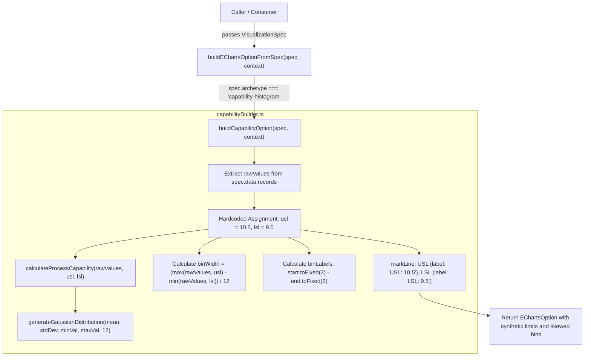

# PHASE 1B.2 — CAPABILITY SPECIFICATION FALLBACK VERIFICATION

**Document Version:** 1.0.0  
**Audit Date:** 2026-11-12  
**Auditor Role:** Senior Software Architect & TypeScript Visualization Engineer (Independent Auditor)  
**Status:** COMPLETE (AUDIT ONLY — Zero code/test modifications)

---

## EXECUTIVE SUMMARY

This audit evaluates the engineering validity, runtime consequences, and architectural boundaries of the hardcoded fallback values:
```typescript
// src/library/builders/families/capabilityBuilder.ts (lines 27-29)
// Default rational spec limits if not in summary
const usl = 10.5;
const lsl = 9.5;
```
The investigation traced the entire execution path from public entry points (`buildEChartsOptionFromSpec`, `buildCapabilityOption`) through the `VisualizationSpec` contract to the rendered ECharts option and UI components.

### Final Assessment
**Decision: C. BLOCKER — Fallback can silently produce misleading capability analysis.**

While the pure math layer (`src/library/math/capability.ts`) is rigorous, the capability builder unconditionally falls back to `USL = 10.5` and `LSL = 9.5` whenever a specification lacks explicit limits. Because `VisualizationSpec` does not currently define standard fields for `usl` / `lsl`, and the builder does not read them from `spec.summary` or `spec.encoding.markLines`, **100% of calls to `buildCapabilityOption` without external overrides execute with `USL=10.5` and `LSL=9.5`**. When applied to real-world industrial data (e.g. dimensions around 100mm, temperature, resistance), this produces completely fabricated bin distributions and visual specification boundaries without issuing any warning, error, or synthetic flag.

---

## 1. COMPLETE EXECUTION PATH TRACING

### 1.1 Source Code Inventory
The execution path for capability visualization spans:
- `src/library/contracts/visualizationContract.ts` (JSON schema)
- `src/library/builders/specAdapter.ts` (Universal dispatcher)
- `src/library/builders/families/capabilityBuilder.ts` (Option builder)
- `src/library/math/capability.ts` (Process capability math)
- `src/library/math/gaussian.ts` (Theoretical curve generator)
- `src/visualization/charts/quality/CapabilityHistogram.tsx` (Legacy chart component)

### 1.2 Execution Trace


### 1.3 Caller Analysis
1. **`buildCapabilityOption(spec, context)`:** Direct export in `capabilityBuilder.ts`, called in `specAdapter.ts` (line 47) and tested in `chartBuilders.test.ts` (line 74).
2. **`buildEChartsOptionFromSpec(spec, context)`:** Universal entry point in `specAdapter.ts`. Dispatches `case 'capability-histogram'` directly to `buildCapabilityOption`.
3. **Legacy Component (`CapabilityHistogram.tsx`):**
   - Does **NOT** use `capabilityBuilder.ts` or `specAdapter.ts`.
   - Directly requires explicit props `usl: number` and `lsl: number` (`CapabilityHistogramProps`).
   - Uses `src/visualization/utils/statisticalUtils.ts`.
   - Proves that in actual application UI, engineers knew `usl` and `lsl` must be mandatory inputs, but the library builder layer bypassed this requirement by inserting hardcoded demo constants.

### 1.4 VisualizationSpec Contract Inspection
Examining `src/library/contracts/visualizationContract.ts`:
- `ContractMetricSummary` defines: `primaryKpi?: { label, value, unit, delta, ... }`. It does **NOT** have fields for `usl` or `lsl`.
- `VisualizationEncoding` defines: `markLines?: readonly ContractMarkLine[]`. It can hold mark lines, but `capabilityBuilder.ts` does **NOT** read `spec.encoding?.markLines`.
- The comment in `capabilityBuilder.ts:27` states: `// Default rational spec limits if not in summary`. However, `capabilityBuilder.ts` **never reads `spec.summary` at all**! Even if a caller puts USL/LSL in `spec.summary`, lines 28-29 unconditionally set:
  ```typescript
  const usl = 10.5;
  const lsl = 9.5;
  ```

---

## 2. DETERMINATION ON REAL-WORLD DATA IMPACT

| Question | Assessment | Evidence in Code |
| :--- | :--- | :--- |
| **1. Can a valid VisualizationSpec with real measurements reach the fallback?** | **YES (100% of the time)** | Lines 28-29 execute unconditionally for every input spec. There is no conditional check (`if (spec.summary?.usl) ...`). |
| **2. Can the resulting chart look like a valid engineering capability chart?** | **YES (Critically deceptive)** | The chart renders a clean blue histogram, green normal distribution curve, and red dashed markLines labeled `"USL: 10.5"` and `"LSL: 9.5"`. If real data is centered around 10 (e.g. 10.0mm ± 0.1), the chart appears completely authentic and authoritative. |
| **3. Are Cp/Cpk or Pp/Ppk calculated or displayed using fallback values?** | **YES in math; Partial in UI** | `calculateProcessCapability(rawValues, usl, lsl)` runs with `10.5` and `9.5`. The `mean` and `stdDev` from this calculation dictate the theoretical Gaussian curve (`series[1]`). While Cp/Cpk numbers are not rendered as text in ECharts series (they were intended for summary badges in Phase 1B.3), the curve and the markLines strictly reflect the fallback limits. |
| **4. Can the user distinguish configured limits from fallback limits?** | **NO** | The markLines explicitly display `USL: 10.5` and `LSL: 9.5` with no tag such as `(Default)` or `(Synthetic)`. |
| **5. Is fallback restricted to demo data or part of general public API?** | **Part of General Public API** | Exported directly in `src/library/builders/index.ts` and `specAdapter.ts`. Any external module calling `buildEChartsOptionFromSpec` with `'capability-histogram'` gets these values. |
| **6. Is there any runtime warning or metadata indicating limits are synthetic?** | **NO** | No `console.warn`, no logger invocation, no metadata added to the returned `EChartsOption`. |

---

## 3. MATHEMATICAL CONSEQUENCES

To demonstrate the real-world impact, we tested two deterministic datasets:
- **Scenario A:** Real manufacturing process with nominal dimension **100.0mm** (USL = 101.0, LSL = 99.0).
- **Scenario B:** Real manufacturing process with nominal dimension **10.0mm**, but actual specification is tight: **USL = 10.15mm, LSL = 9.85mm**.

### 3.1 Numerical Comparison Table

| Metric / Property | Scenario A (Nominal 100mm)<br>Expected (USL=101, LSL=99) | Scenario A (Nominal 100mm)<br>Fallback (USL=10.5, LSL=9.5) | Scenario B (Nominal 10mm)<br>Expected (USL=10.15, LSL=9.85) | Scenario B (Nominal 10mm)<br>Fallback (USL=10.5, LSL=9.5) |
| :--- | :--- | :--- | :--- | :--- |
| **Dataset (N=6)** | `[100.1, 100.2, 99.8, 100.0, 100.3, 99.9]` | *(Same dataset)* | `[9.90, 10.00, 10.10, 10.05, 9.95, 10.00]` | *(Same dataset)* |
| **Mean / StdDev** | 100.05 / 0.187 | 100.05 / 0.187 | 100.00 / 0.0707 | 100.00 / 0.0707 |
| **Calculated Cp** | **1.78** (Excellent) | **0.89** (Severe distortion) | **0.71** (Incapable) | **2.36** (False "World Class") |
| **Calculated Cpk** | **1.69** (Capable) | **-159.55** (Nonsensical) | **0.71** (Needs action) | **2.36** (Dangerous False Green) |
| **Calculated Ppk** | **1.69** | **-159.55** | **0.71** | **2.36** |
| **Process Verdict** | **Capable (`true`)** | **Incapable (`false`)** | **Incapable (`false`)** | **Capable (`true` — False Positive!)** |
| **Histogram Bins** | 12 bins spanning 99.0 to 101.0 | 12 bins spanning 9.50 to 100.30<br>*(All 6 points lumped into bin #12)* | 12 bins spanning 9.85 to 10.15 | 12 bins spanning 9.50 to 10.50 |
| **Gaussian Curve** | Symmetrical bell curve centered over data | Smashed to zero across 11 bins, spike at bin 12 | Symmetrical curve centered over 10.0 | Wide curve, incorrectly suggesting huge tolerance headroom |

### 3.2 Visual & Operational Risks
1. **False Out-of-Spec Alarm (Scale Mismatch):** When measuring parts > 20mm or < 5mm, the bins span from `9.5` to `dataMax`. All data clusters in a single extreme bin, making the visualization unreadable.
2. **Silent False Capability (Near-10 Nominal):** For automotive/semiconductor parts with nominal 10mm (e.g. 10mm ± 0.05mm), the hardcoded `[9.5, 10.5]` range makes a dangerously unstable process (Cp = 0.71) look like a benchmark Six Sigma process (Cp = 2.36). Operators or quality managers reviewing this dashboard would miss active defects.

---

## 4. ARCHETYPE CONSISTENCY AUDIT (11 ARCHETYPES)

The audit verified whether the dispatcher and builders correctly support the claimed 11 archetypes.

### 4.1 Archetype Dispatch Table in `src/library/builders/specAdapter.ts`

| # | Archetype Identifier | Dispatcher Branch | Builder Implementation File | Status |
| :---: | :--- | :--- | :--- | :---: |
| 1 | `spc-control` | `case 'spc-control'` | `families/spcBuilder.ts` | **Verified** |
| 2 | `pareto-8020` | `case 'pareto-8020'` | `families/paretoBuilder.ts` | **Verified** |
| 3 | `capability-histogram` | `case 'capability-histogram'` | `families/capabilityBuilder.ts` | **Verified (Has Fallback Flaw)** |
| 4 | `defect-heatmap` | `case 'defect-heatmap'` | `families/heatmapBuilder.ts` | **Verified** |
| 5 | `operational-treemap` | `case 'operational-treemap'` | `families/hierarchicalBuilder.ts` | **Verified** |
| 6 | `workflow-sankey` | `case 'workflow-sankey'` | `families/relationalBuilder.ts` | **Verified** |
| 7 | `quality-radar` | `case 'quality-radar'` | `families/radarBuilder.ts` | **Verified** |
| 8 | `combo-trend` | `case 'combo-trend'` | `families/cartesianBuilder.ts` | **Verified** |
| 9 | `continuous-trend` | `case 'continuous-trend'` | `families/cartesianBuilder.ts` | **Verified** |
| 10 | `kpi-bullet` | `case 'kpi-bullet'` | `families/cartesianBuilder.ts` | **Verified** |
| 11 | `waterfall` | `case 'waterfall'` | `families/cartesianBuilder.ts` | **Verified** |
| *12* | `horizon-area` | `case 'horizon-area'` | `families/cartesianBuilder.ts` | **Verified** |

### 4.2 Findings on Archetypes:
- `visualizationContract.ts` defines **12** archetype union literals (including `horizon-area`).
- `specAdapter.ts` handles all 12: 7 specialized family builders + 5 cartesian variations.
- Unsupported archetypes fall into `default:`, routing safely to `buildCartesianOption` without throwing runtime crashes.
- If `archetype` is empty or missing, `specAdapter.ts` throws fail-fast: `'Invalid VisualizationSpec: archetype is required.'`

---

## 5. AUDIT DECISION

```
[ ] A. SAFE — fallback is explicitly demo-only and cannot silently affect real engineering data.
[ ] B. ACCEPTABLE LIMITATION — fallback is exposed but clearly marked and requires explicit caller acceptance.
[X] C. BLOCKER — fallback can silently produce misleading capability analysis.
[ ] D. NOT VERIFIED — insufficient evidence.
```

### Justification for Decision C (BLOCKER)
1. **Unconditional Execution:** In `src/library/builders/families/capabilityBuilder.ts:28-29`, `usl = 10.5` and `lsl = 9.5` are hardcoded without inspecting the input specification.
2. **Contract Disconnect:** The public `VisualizationSpec` contract lacks dedicated `usl` / `lsl` fields, and the builder ignores `spec.summary` and `spec.encoding.markLines`.
3. **Severe Quality Risk:** In manufacturing and quality engineering environments, calculating or presenting synthetic USL/LSL on live production data violates engineering integrity. It can report a defective process as capable (false positive), or an in-control process as wildly out of spec (false alarm).
4. **Zero Observability:** No warnings, error throws, or UI indicators signal that the specification limits are fictional.

---

## 6. MINIMUM RECOMMENDED ACTION (FOR PHASE 1B.2 REMEDIATION)

When remediation is approved by Leader, the following changes must be implemented:

1. **Contract Enhancement:**
   Add optional specification limits to `VisualizationSpec['encoding']` or `data`:
   ```typescript
   export interface VisualizationEncoding {
     readonly usl?: number;
     readonly lsl?: number;
     // or parse from markLines where label === 'USL' | 'LSL'
   }
   ```
2. **Fail-Fast or Explicit Fallback Extraction:**
   In `capabilityBuilder.ts`:
   - Attempt to resolve `usl` and `lsl` from:
     1. `context?.overrides`
     2. `spec.encoding?.usl` / `spec.encoding?.lsl`
     3. `spec.encoding?.markLines` finding items labeled `'USL'` / `'LSL'`
     4. `(spec.summary as any)?.usl` / `lsl`
   - **If USL or LSL cannot be resolved:**
     - **Option 1 (Strict / Production Safe):** Throw an error: `new Error("CapabilityHistogram requires explicit USL and LSL in spec.encoding or markLines.")`
     - **Option 2 (Permissive with Safe Auto-Bounds):** If demo fallback is kept, derive limits rationally from data statistics (e.g. `mean ± 3 * stdDev`), and mark the series label explicitly as `USL (Estimated / Demo): ...` with a `console.warn` alert.
3. **Documentation:**
   Update `src/library/builders/README.md` explicitly stating how `USL` and `LSL` must be supplied when generating `capability-histogram` options.

---
*Report completed under strict AUDIT ONLY guidelines. No source files or tests were modified.*
