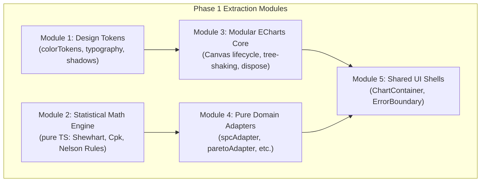

# PHASE 1 PRE-FLIGHT & EXTRACTION SPECIFICATION
**Document Identifier:** `docs/PHASE_1_PREFLIGHT.md`  
**Role:** Principal Software Architect & Release Engineer  
**Status:** Pre-Flight Verification & Execution Checklist (Ready for Approval)  
**Date:** November 2026

---

## 1. PRE-FLIGHT VERIFICATION MATRIX

Phase 1 executes the extraction of the **reusable core foundation** into an isolated, domain-agnostic folder (`src/library/`). To guarantee zero regression on the running application, every extraction is specified below with exact source/target mappings, interfaces, risks, and rollback protocols.



---

## 2. DETAILED EXTRACTION SPECIFICATIONS

### MODULE 1: DESIGN TOKENS EXTRACTION
- **Source Files:**
  - `src/visualization/tokens/chartTokens.ts`
  - `src/visualization/playground/themes/playgroundThemes.ts`
  - `tailwind.config.js`
- **Target Files:**
  - `src/library/tokens/colorTokens.ts`
  - `src/library/tokens/typographyTokens.ts`
  - `src/library/tokens/shadowTokens.ts`
  - `src/library/tokens/index.ts`
- **Dependencies:** None (Pure TypeScript constants & CSS variables).
- **Public Interfaces:**
  ```typescript
  export const WARM_GLASS_TOKENS: ThemeTokens;
  export const OPERATIONAL_DARK_TOKENS: ThemeTokens;
  export const HIGH_CONTRAST_TOKENS: ThemeTokens;
  export const CHART_PALETTES: Record<string, string[]>;
  ```
- **Migration Steps:**
  1. Create `src/library/tokens/` and author typed token exports.
  2. In original files (`chartTokens.ts`, `playgroundThemes.ts`), replace internal constants with re-exports from `src/library/tokens/` (`export * from '../../library/tokens'`).
  3. Verify zero breaking changes via `pnpm build`.
- **Regression Risks:** Broken color references in Tailwind classes if names mismatch.
- **Verification Tests:** Run `pnpm build` and verify that Tailwind classes resolve in DOM.
- **Rollback Strategy:** Delete `src/library/tokens/` and revert `chartTokens.ts` to git HEAD.

---

### MODULE 2: STATISTICAL UTILITIES EXTRACTION
- **Source Files:**
  - `src/visualization/utils/statisticalUtils.ts`
- **Target Files:**
  - `src/library/math/statisticalUtils.ts`
  - `src/library/math/nelsonRules.ts`
  - `src/library/math/index.ts`
- **Dependencies:** None (Pure TypeScript). Zero React, zero DOM.
- **Public Interfaces:**
  ```typescript
  export function calculateMean(values: number[]): number;
  export function calculateStandardDeviation(values: number[]): number;
  export function calculateSpcLimits(values: number[], sigmaMultiplier?: number): SpcLimits;
  export function calculateProcessCapability(values: number[], usl: number, lsl: number): ProcessCapabilityResult;
  export function evaluateNelsonRules(values: number[], limits: SpcLimits): NelsonRuleViolation[];
  export function generateGaussianNormalCurve(mean: number, stdev: number, minX: number, maxX: number, steps?: number): Array<[number, number]>;
  ```
- **Migration Steps:**
  1. Copy and enrich math functions into `src/library/math/`.
  2. Implement unit tests in `src/library/math/__tests__/statisticalUtils.test.ts`.
  3. Turn `src/visualization/utils/statisticalUtils.ts` into a compatibility re-export.
- **Regression Risks:** Formula drift or rounding differences in Cpk/Spc values.
- **Verification Tests:** Automated Vitest/Node math test asserting known statistical benchmark values (e.g., standard normal variance = 1.0, Nelson rule 1 trigger on $+3.5\sigma$).
- **Rollback Strategy:** Revert `src/visualization/utils/statisticalUtils.ts` and remove `src/library/math/`.

---

### MODULE 3: MODULAR ECHARTS CORE & LIFECYCLE MANAGEMENT
- **Source Files:**
  - `src/visualization/core/EChartsWrapper.tsx`
  - Monolithic `import * as echarts from 'echarts'` across components.
- **Target Files:**
  - `src/library/core/echartsCore.ts` (Tree-shaken modular bundle)
  - `src/library/core/EChartsWrapper.tsx` (Decoupled lifecycle wrapper)
- **Dependencies:** `echarts/core`, `echarts/charts`, `echarts/components`, `echarts/renderers`, `react` (^18 or ^19).
- **Public Interfaces:**
  ```typescript
  export interface EChartsWrapperProps {
    option: echarts.EChartsOption;
    height?: number | string;
    className?: string;
    theme?: string;
    loading?: boolean;
    renderer?: 'canvas' | 'svg';
    onChartClick?: (params: echarts.ECElementEvent) => void;
  }
  export const EChartsWrapper: React.FC<EChartsWrapperProps>;
  ```
- **Migration Steps:**
  1. Create `echartsCore.ts` registering only the 10 required series and components.
  2. Move `EChartsWrapper.tsx` to `src/library/core/`, importing `echarts` from `echartsCore.ts`.
  3. Ensure `chartInstance.dispose()` and debounced `ResizeObserver` remain intact.
  4. Alias legacy `src/visualization/core/EChartsWrapper.tsx` to re-export from new path.
- **Regression Risks:** Missing series type registration causing runtime `Series xxx not found` error.
- **Verification Tests:** Render every chart in the Playground; verify no console warnings.
- **Rollback Strategy:** Revert import in `EChartsWrapper.tsx` back to monolithic `echarts`.

---

### MODULE 4: PURE DOMAIN ADAPTERS EXTRACTION
- **Source Files:**
  - `src/visualization/playground/adapters/playgroundOptionBuilder.ts`
- **Target Files:**
  - `src/library/adapters/spcAdapter.ts`
  - `src/library/adapters/paretoAdapter.ts`
  - `src/library/adapters/capabilityAdapter.ts`
  - `src/library/adapters/heatmapAdapter.ts`
  - `src/library/adapters/bulletAdapter.ts`
  - `src/library/adapters/waterfallAdapter.ts`
  - `src/library/adapters/sankeyAdapter.ts`
  - `src/library/adapters/treemapAdapter.ts`
  - `src/library/adapters/radarAdapter.ts`
  - `src/library/adapters/comboTrendAdapter.ts`
  - `src/library/adapters/index.ts`
- **Dependencies:** Pure math utilities, token definitions, ECharts option types.
- **Public Interfaces:**
  ```typescript
  export type ChartAdapter<TInput, TOptions = Record<string, unknown>> = (
    input: TInput,
    theme: ThemeId,
    options?: TOptions
  ) => echarts.EChartsOption;
  ```
- **Migration Steps:**
  1. Break down the 800-line monolithic `playgroundOptionBuilder.ts` into individual modular pure adapter files.
  2. Re-export all builders from `src/library/adapters/index.ts`.
  3. Update `playgroundOptionBuilder.ts` to delegate to these specialized adapters.
- **Regression Risks:** Option structure drift causing visual styling differences.
- **Verification Tests:** Run side-by-side verification in the Playground comparing before vs after options.
- **Rollback Strategy:** Restore single file `playgroundOptionBuilder.ts`.

---

### MODULE 5: SHARED VISUALIZATION UI COMPONENTS
- **Source Files:**
  - `src/visualization/components/ChartContainer.tsx`
  - `src/components/common/ErrorBoundary.tsx`
- **Target Files:**
  - `src/library/core/ChartContainer.tsx`
  - `src/library/core/ErrorBoundary.tsx`
- **Dependencies:** `react`, `lucide-react`, `clsx`, `tailwind-merge`.
- **Public Interfaces:**
  ```typescript
  export interface ChartContainerProps {
    title: string;
    subtitle?: string;
    kpiValue?: string | number;
    kpiDelta?: string;
    kpiStatus?: 'positive' | 'negative' | 'neutral' | 'warning';
    onExportCsv?: () => void;
    onExportPng?: () => void;
    children: React.ReactNode;
  }
  ```
- **Migration Steps:**
  1. Move components to `src/library/core/`.
  2. Set up backward compatibility re-exports in old locations.
- **Regression Risks:** Prop type breakage in views using `ChartContainer`.
- **Verification Tests:** `pnpm build` and manual inspection of chart cards.
- **Rollback Strategy:** Revert files to original directories.

---

## 3. CROSS-PROJECT PROOF-OF-REUSE VALIDATION STRATEGY

To objectively prove that `src/library/` is truly framework-agnostic and free from business domain dependencies, the following test protocol is established:

```
┌───────────────────────────────────────────────────────────────────────────────┐
│                    PROOF-OF-REUSE TEST PROTOCOL                               │
├───────────────────────────────────────────────────────────────────────────────┤
│ 1. Minimal Consumer Sandbox:                                                  │
│    Create a standalone scratch app (or isolate a branch in IQC_nexus).        │
│                                                                               │
│ 2. Isolated Import Test:                                                      │
│    Copy ONLY `src/library/` (Zero files from `src/components/factory`,         │
│    `src/components/dashboard`, or `src/data/`).                               │
│                                                                               │
│ 3. Verification Criteria:                                                     │
│    ✓ Compile without missing module errors.                                   │
│    ✓ Render an SPC Control Chart using arbitrary synthetic telemetry.         │
│    ✓ Apply Warm Glass theme and Dark Analytics theme dynamically.             │
│    ✓ Verify unmount disposal cleanly without console memory leaks.            │
│    ✓ Verify zero references to "Glove", "MES", "ARR", or proprietary terms.   │
└───────────────────────────────────────────────────────────────────────────────┘
```
