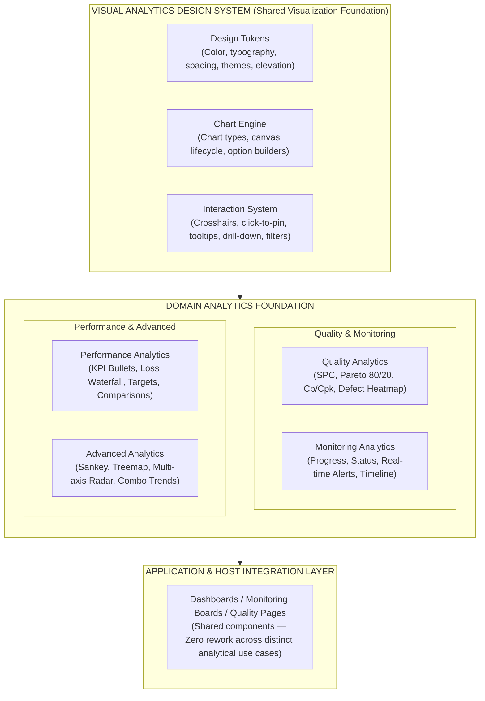
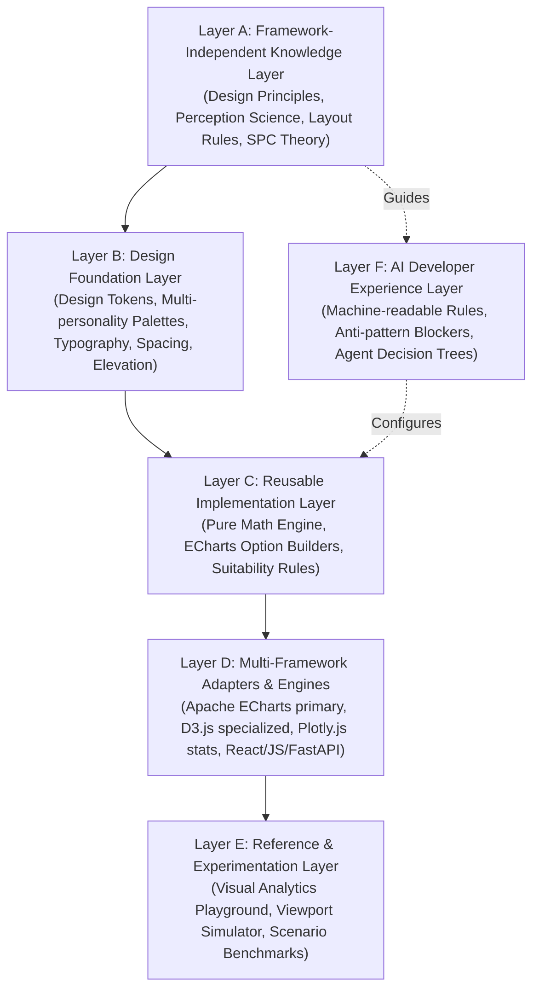

# PRODUCT ARCHITECTURE: VISUAL DESIGN INTELLIGENCE LIBRARY
**Document Identifier:** `docs/PRODUCT_ARCHITECTURE.md`  
**Role:** Principal Software Architect & Design Systems Architect  
**Status:** Architecture Blueprint & Separation of Concerns Specification  
**Version:** 2.1.0

---

## 1. HIGH-LEVEL PRODUCT ARCHITECTURE

The repository is structured as a **Framework-Independent Visual Analytics & Graphic System**. The browser-based React application serves strictly as an **interactive laboratory, documentation portal, and experimentation playground** to test, benchmark, and extract reusable assets, rather than defining the library itself.

### Architectural Hierarchy



> **Core Value Proposition:**
> *"When a new chart archetype or visual standard is added to the system, all dashboards, monitoring boards, and quality pages across multiple products immediately gain access to it without rewriting code from scratch."*

---

## 2. THE SIX FORMAL ARCHITECTURAL LAYERS

To ensure true framework independence, cross-project portability, and AI-agent compatibility, the library partitions all capabilities into six explicit layers (A to F):



### Layer A: Framework-Independent Knowledge Layer
- **Cognitive & Perception Science:** 60-30-10 color allocation, Tableau eye-tracking heatpaths, Miller's Law (5±2 metrics per card), zero-chart-junk data-ink ratio.
- **Statistical Quality Theory:** ISO 7870-2 Shewhart control chart standards, Wheeler's empirical rule violations (Nelson Rules 1–4), Juran's Pareto 80/20 triage, Motorola $6\sigma$ short-term vs long-term capability ($C_p/C_{pk}$ vs $P_p/P_{pk}$).
- **Interaction Standards:** Zero-obscuration axis crosshairs, click-to-pin tooltips, pause-on-hover telemetry streaming.

### Layer B: Design Foundation Layer
- **Universal Design Tokens (`src/library/tokens/`):** Token contracts exported as typed TypeScript constants, JSON schemas, and CSS Custom Properties.
- **Dual Visual Personalities:**
  - *Warm Glass:* Translucent ivory, cream, terracotta, and soft roast brown with specular rims for executive desktop dashboards.
  - *Operational High-Contrast:* 100% opaque slate and white surfaces with WCAG AAA contrast for plant-floor tablets and NOC video walls.
- **5 Theme Registrations:** Declarative themes registered for both CSS and Apache ECharts (*Light Enterprise, Dark Analytics, Warm Glass, Minimal Monochrome, High Contrast*).

### Layer C: Reusable Implementation Layer
- **Pure Statistical Math Engine (`src/library/math/`):** Zero-dependency TypeScript functions (`calculateSpcLimits`, `evaluateNelsonRules`, `calculateProcessCapability`, `generateGaussianCurve`, `calculateParetoDistribution`).
- **Decoupled Option Builders (`src/library/adapters/`):** Pure deterministic functions converting generic data arrays into strongly-typed `EChartsOption` objects with zero DOM or React state dependencies.
- **Methodological Suitability Engine:** Automated rules flagging inappropriate chart assignments (e.g., attempting pie charts with $>4$ slices or using categorical bars for continuous time series).

### Layer D: Multi-Framework & Multi-Engine Adapters
The platform acknowledges that enterprise systems operate on diverse technology stacks (React, Vue, Vanilla JavaScript, Python / FastAPI). Rather than forcing all consumers to adopt a heavy React framework, the architecture provides targeted adapters:

#### Chart Engine Roles & Boundary Matrix
| Engine | Strategic Role in Library | Target Use Cases | Library Status |
| :--- | :--- | :--- | :--- |
| **Apache ECharts** | **Primary Baseline Engine** | 90%+ of all enterprise dashboards: SPC, Pareto, Capability, Heatmaps, Sankey, Treemap, Bullet, Waterfall, Combo Trends. | **Core Mandatory Engine** (Tree-shaken) |
| **D3.js** | **Specialized Custom Graphics** | Bespoke non-standard SPC overlays, specialized mechanical gauges, custom geometric diagrams where SVG DOM path control is needed. | **Supplementary / On-Demand** (Not bundled in core) |
| **Plotly.js** | **Scientific & High-Order Stats** | Multi-dimensional statistical distributions, kernel density estimations (KDE), violin plots, 3D surface topologies. | **Supplementary / On-Demand** (Not bundled in core) |

#### Consumer Framework Adapters
1. **React / Next.js Adapter:** High-performance `EChartsWrapper.tsx` handling Canvas lifecycle, ResizeObserver debounce, and unmount disposal.
2. **Vanilla JavaScript / HTML Adapter:** Self-contained ES Module helper (`initEChart(containerId, options)`) with native CSS variable binding.
3. **Python / FastAPI / SSR Adapter:** Backend JSON serializer generating valid ECharts option dictionaries for Jinja2 template embedding.

### Layer E: Reference & Experimentation Layer
- **Visual Analytics Playground (`src/visualization/playground/`):** Interactive laboratory allowing engineers and product owners to toggle themes, alter datasets, inject noise, test anomalies, and inspect live chart configurations.
- **Multi-Archetype Showcase:** 12 golden visualization archetypes demonstrating industrial QA, executive KPIs, and operational monitoring.
- **Cross-Device Viewport Simulator:** Testing responsiveness across Desktop (1600px), Laptop (1280px), Tablet (768px), and Kiosk displays.

### Layer F: AI Developer Experience Layer
- **Machine-Readable Rules (`.ai/rules/`):** Strict, token-conscious markdown files ingested by AI coding agents (Antigravity, Cursor, Claude Code) before generating code.
- **Anti-Pattern Enforcement:** Explicitly forbids AI hallucinations (e.g. banning 3D effects, bright rainbow palettes, unrounded floating points, or mislabeled trendlines).
- **Architecture Blueprints & Recipes:** Step-by-step implementation guides with copy-paste code snippets for rapid agent scaffolding.

---

## 3. STRICT SEPARATION OF CONCERNS CONTRACT

```
┌───────────────────────────────────────────────────────────────────────────────┐
│                     SEPARATION OF CONCERNS CONTRACT                           │
├──────────────────────────┬─────────────────────────────┬──────────────────────┤
│ LAYER                    │ WHAT IT CONTAINS            │ WHAT IT CANNOT DO    │
├──────────────────────────┼─────────────────────────────┼──────────────────────┤
│ 1. Design Tokens         │ JSON / CSS variable values, │ Cannot import React, │
│    & Foundations         │ color hexes, spacing, fonts │ ECharts, or DOM APIs │
├──────────────────────────┼─────────────────────────────┼──────────────────────┤
│ 2. Math & Logic          │ Pure TypeScript functions   │ Cannot import React, │
│    Engine                │ (SPC, Cpk, Nelson rules)    │ CSS, or visual styles│
├──────────────────────────┼─────────────────────────────┼──────────────────────┤
│ 3. Chart Option          │ Pure functions returning    │ Cannot access DOM,   │
│    Builders (Adapters)   │ EChartsOption configurations│ window, or useState  │
├──────────────────────────┼─────────────────────────────┼──────────────────────┤
│ 4. Reusable Components   │ Presentation React/UI shells│ Cannot contain hard- │
│    & Canvas Wrappers     │ (EChartsWrapper, Container) │ coded business data  │
├──────────────────────────┼─────────────────────────────┼──────────────────────┤
│ 5. Reference Examples    │ Golden reference charts     │ Cannot be locked to  │
│    & Archetypes          │ wired to synthetic datasets │ proprietary schemas  │
├──────────────────────────┼─────────────────────────────┼──────────────────────┤
│ 6. Host Application      │ Interactive Playground,     │ Is NOT the library   │
│    (Explorer Shell)      │ Viewport simulator, Gallery │ itself; just a viewer│
└──────────────────────────┴─────────────────────────────┴──────────────────────┘
```

### Domain Independence Rules
- The core library **must never contain hardcoded references** to specific customer products, proprietary line numbers, or internal acronyms (e.g. "Latex Glove Compounding", "Samsung Gumi Line 4").
- All reference examples utilize **generalized industrial schemas**:
  - Continuous telemetry: `{ timestamp: string, value: number, sampleId: string }`
  - Discrete defect Pareto: `{ name: string, count: number, unitCost: number, severity: string }`
  - Flow network: `{ source: string, target: string, value: number }`
  - Multi-axis benchmark: `{ indicators: [...], series: [...] }`
