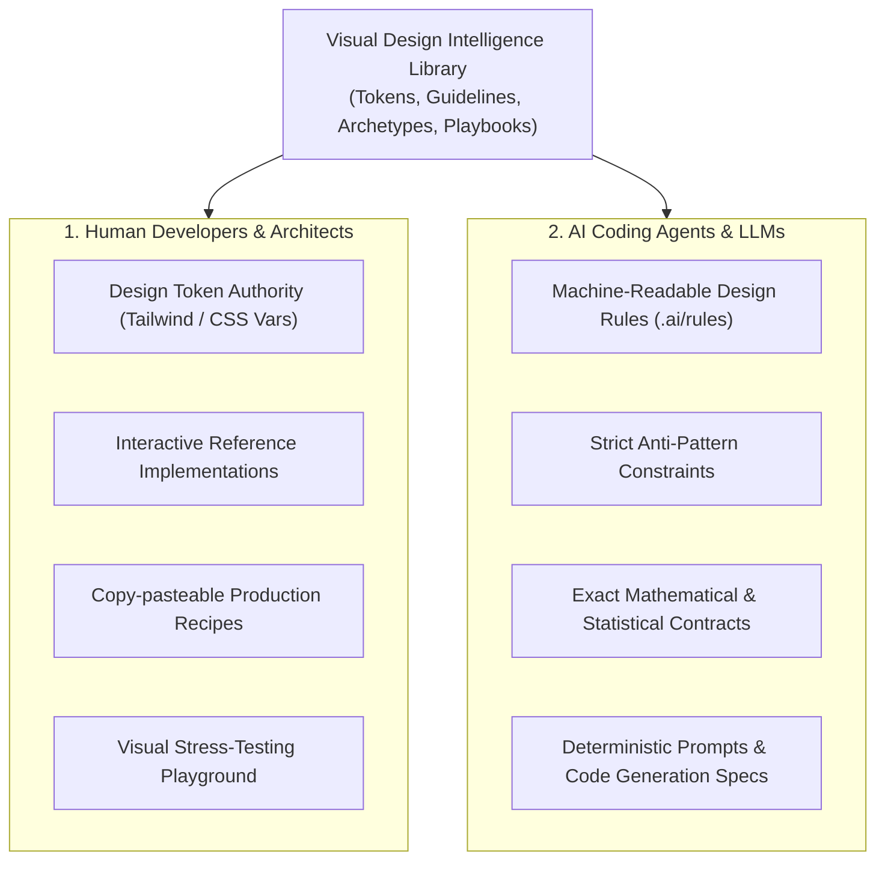

# PRODUCT VISION: VISUAL DESIGN INTELLIGENCE LIBRARY
**Document Identifier:** `docs/PRODUCT_VISION.md`  
**Role:** Principal Software Architect, Design Systems Architect & AI Developer Experience Engineer  
**Status:** Approved Product Vision & Strategic Charter  
**Version:** 2.0.0 (Repositioned Core Identity)

---

## 1. STRATEGIC REPOSITIONING: WHAT THIS PROJECT IS & IS NOT

```
┌───────────────────────────────────────────────────────────────────────────────┐
│                           CORE IDENTITY SHIFT                                 │
├──────────────────────────────────────┬────────────────────────────────────────┤
│ WHAT THIS REPOSITORY IS NOT          │ WHAT THIS REPOSITORY IS                │
├──────────────────────────────────────┼────────────────────────────────────────┤
│ ❌ A single-purpose SaaS dashboard   │ ✅ A Reusable Visual Design            │
│    for marketing or sales CRM        │    Intelligence Library                │
│                                      │                                        │
│ ❌ A proprietary MES / SCADA shop-   │ ✅ A Cross-Project Design Knowledge    │
│    floor production tool             │    Base & Token Authority              │
│                                      │                                        │
│ ❌ A collection of hardcoded, domain-│ ✅ A Component Reference & Archetype   │
│    locked business screens           │    Implementation Guide                │
│                                      │                                        │
│ ❌ A static UI kit / marketing mockup│ ✅ A Live Visual Experimentation &     │
│    showcase                          │    Stress-Testing Laboratory           │
└──────────────────────────────────────┴────────────────────────────────────────┘
```

### The Core Problem It Solves
Across enterprise web engineering, development teams and generative AI coding assistants suffer from:
1. **"AI Slop" & Generic Aesthetics:** AI models default to generic Bootstrap templates, harsh fluorescent gradients, low-contrast translucent cards, unreadable floating tooltips, and clashing nested borders.
2. **Reinventing the Wheel:** Every new internal dashboard, monitoring tool, or administrative panel rebuilds color palettes, card shells, time-series zoom controls, and export facilities from scratch.
3. **Statistical & Visual Illiteracy:** Engineers frequently select misleading chart types (e.g. multi-slice pie charts for 10 defect categories, raw trendlines labeled as SPC control charts, or bar charts masking multimodal skewness).
4. **Lack of an Experimentation Playground:** Components are coded directly into production views without being stress-tested against empty states, extreme outlier values, responsive breakpoints, or dark/light theme switching.

### The Solution: The Visual Design Intelligence Library
This repository serves as a **centralized, reusable visual design intelligence library**. Its purpose is to guide human developers and autonomous AI coding agents in designing, building, auditing, and validating high-density, ergonomically superior user interfaces across diverse projects.

---

## 2. THE DUAL AUDIENCE



### Audience 1: Human Frontend Developers & System Architects
- **Component Benchmark:** Discover battle-tested, high-performance UI patterns and data visualization components.
- **Copy-Paste Implementation Recipes:** Pre-integrated recipes combining Tailwind CSS, Framer Motion, and Apache ECharts.
- **Laboratory Validation:** Test new visualizations against extreme synthetic datasets before embedding them into client deliverables.

### Audience 2: Autonomous AI Coding Agents (Antigravity, Claude Code, Cursor)
- **Knowledge Priming:** High-trust primary source for how enterprise dashboards must be constructed.
- **Guardrails Against Hallucination:** Explicit rules preventing AI agents from inventing ad-hoc hex colors, omitting chart `.dispose()` memory routines, or confusing customer specification limits ($USL/LSL$) with statistical process control limits ($UCL/LCL$).
- **Reproducible Design Tokens:** Structured tokens that agents can import directly without generating inconsistent inline styles.

---

## 3. CORE DESIGN PILLARS

The library is governed by five foundational pillars:

### Pillar 1: Framework-Agnostic Design Foundations
Visual tokens (colors, spatial scales, typographic hierarchies, specular highlights, and surface elevation curves) are defined as pure, framework-independent specifications. While the host browser interface uses React and Tailwind, the underlying tokens are easily exported to Vanilla CSS, Next.js, Vue, Svelte, or Python/FastAPI templates.

### Pillar 2: Industrial-Grade Data Visualization (ECharts & Canvas)
Replaces fragile SVG rendering for high-density telemetry with hardware-accelerated HTML5 Canvas / WebGL via Apache ECharts. Incorporates Observable Plot interaction grammars (zero-obscuration crosshairs, decoupled pointer snapping, click-to-pin tooltips) and strict Six Sigma statistical rigor (ISO 7870-2 / AIAG SPC).

### Pillar 3: Dual Aesthetic Profiles (Warm Glass vs Operational High-Contrast)
Acknowledges that one aesthetic cannot serve all viewing environments:
- **Profile A (Executive / Warm Glass):** Atmospheric, warm neutral palette (ivory, cream, terracotta, beige) with delicate glass specular rims for controlled desktop environments.
- **Profile B (Operational / High-Contrast):** 100% opaque, high-contrast, flat panels with bold semantic badges engineered for harsh factory lighting and large-screen monitoring.

### Pillar 4: Interactive Experimentation Environment (The Playground)
A live browser workbench that allows engineers and AI agents to test any visualization component against realistic scenario datasets, 5 enterprise themes, side-by-side comparison matrices, and 4 simulated device viewports (Desktop, Laptop, Tablet, Mobile) prior to production deployment.

### Pillar 5: AI Design Playbooks & Governance
Actionable checklists, decision trees, and non-negotiable coding rules designed to be consumed directly by LLM context windows to enforce consistent, production-grade output across any paired programming session.

---

## 4. WHAT SUCCESS LOOKS LIKE

1. A new project needs a quality dashboard: Instead of coding from scratch, the developer or AI agent imports the token system, copies the tested `SpcControlChart` and `ParetoChart8020` recipes, and wires real API data in under 30 minutes.
2. An AI agent is tasked with building a production overview: It queries the library's decision tree, avoids prohibited anti-patterns (such as multi-slice pie charts or 3D bars), selects a Bullet Chart and Small Multiples, and generates zero-defect, leak-free code.
3. The repository codebase becomes the canonical source of truth for UI/UX engineering excellence across all paired projects.
