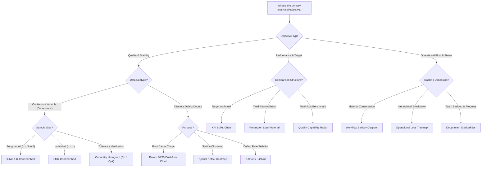

# 03. ENTERPRISE CHART SELECTION GUIDE 2026
**Document:** `docs/visual-analytics-research/03_CHART_SELECTION_GUIDE.md`  
**Standard:** Analytical Decision Framework for Manufacturing & Enterprise Dashboards  

---

## 1. THE ANALYTICAL QUESTION-DRIVEN SELECTION MATRIX

A common failure mode in AI-generated dashboards is selecting charts based on visual aesthetics rather than analytical inquiry. The table below maps specific operational questions directly to the optimal visualization archetype:

| Operational / Quality Inquiry | Primary Chart | Fallback / Alternative | Why This Chart Is Selected |
| :--- | :--- | :--- | :--- |
| **"Which defects cause 80% of scrap loss by cost vs frequency?"** | **Pareto 80/20 (COPQ Weighted)** | Ranked Horizontal Bar | Isolates vital few causes using dual-axis frequency/cost and cumulative percentage. |
| **"Is our production process statistically stable over time?"** | **SPC Control Chart (I-MR / X-bar & R)** | Trend Line with $\pm 3\sigma$ bounds | Standard trend lines cannot identify assignable cause variations or Nelson rule violations. |
| **"Does the process meet short-term capability vs long-term specs?"** | **Process Capability (Cp/Cpk & Pp/Ppk)** | Boxplot with Spec Limits | Compares empirical distribution against specification limits ($USL/LSL$) with Gaussian fit. |
| **"Which machine stations or lines have abnormal defect spikes?"** | **Spatial Defect Heatmap** | Small Multiples Grid | Matrix grid exposes spatial clusters without requiring multiple overlapping line charts. |
| **"Which machines exhibit the widest measurement variation?"** | **Multi-Station Boxplot** | Jittered Strip Plot | Shows median, interquartile spread ($IQR$), and outliers without aggregation bias. |
| **"How does daily output compare against shift targets?"** | **Bullet Chart** | Target vs. Actual Bar | Visualizes target achievement within qualitative performance zones in a compact footprint. |
| **"Where in the line does scheduled capacity get lost?"** | **Production Loss Waterfall** | Stacked Loss Bar | Bridges the sequential reduction from Gross Planned Capacity to Net Good Output. |
| **"How does material flow, recirculate in rework, and scrap?"** | **Workflow Sankey Diagram** | Process State Flowchart | Directed flow ribbons preserve volume conservation across production stages. |
| **"How do suppliers compare across 5+ quality dimensions?"** | **Quality Radar Chart** | Parallel Coordinates Plot | Normalizes orthogonal metrics (precision, yield, speed, compliance, MTBF) onto a single glyph. |
| **"Does running machines faster cause higher defect rates?"** | **Combo Bar + PPM Line** | Bivariate Scatter Plot | Evaluates volume throughput on left axis against defect PPM on right axis simultaneously. |
| **"How is workload progress distributed across departments?"** | **Stacked Department Bar** | Segmented Progress Rings | Compares absolute workload volume and relative completion status across teams. |
| **"Are defect occurrences correlated with day-of-week patterns?"** | **Calendar Activity Heatmap** | Grouped Day-of-Week Bar | Exposes multi-month seasonal and day-of-week cyclical anomalies across shifts. |

---

## 2. DECISION TREE FOR CHART SELECTION

---

## 3. SELECTION ANTI-PATTERNS (WHEN NOT TO USE A CHART)

### Anti-Pattern 1: The Raw Trend Line Mistaken for an SPC Control Chart
- **The Mistake:** Plotting raw measurement values over time with an arbitrary average line and calling it a "Control Chart".
- **Why It Fails:** Process control limits ($UCL, LCL$) are computed statistically from subgroup variation ($\pm 3\sigma / d_2$ or $\pm 2.66\overline{MR}$). A simple trend line without verified limits gives false confidence or triggers false alarms on natural common-cause noise.
- **Rule:** Never label a chart "SPC" unless it calculates true control limits and flags assignable cause violations (Nelson Rules).

### Anti-Pattern 2: The Multi-Slice Donut / Pie Chart for Defect Root Causes
- **The Mistake:** Using a pie chart with 8+ defect slices (Pin Hole, Thin, Tear, Stain, Cuff, Bubble, Burn, Other).
- **Why It Fails:** Human perception cannot accurately decode subtle angular differences. Angles fail to communicate the cumulative 80/20 inflection point needed for quality intervention.
- **Rule:** If categories exceed 4, **banned**. Replace with a Pareto 80/20 chart or ranked horizontal bar.

### Anti-Pattern 3: The Spaghetti Line Chart (8+ Overlapping Series)
- **The Mistake:** Cramming 8 production lines onto a single line chart to "save space".
- **Why It Fails:** Lines crisscross into visual noise; hover crosshairs trigger seizure-inducing tooltip flickers; line identification requires constant legend back-and-forth scanning.
- **Rule:** When comparing more than 4 time-series lines, use **Faceted Small Multiples** (parallel synchronized mini-charts sharing identical scales).

### Anti-Pattern 4: The 3D Chart Gimmick
- **The Mistake:** 3D bar charts, tilted pie charts, or 3D surface plots for standard operational metrics.
- **Why It Fails:** Perspective distortion causes foreground bars to appear artificially larger than taller background bars; occludes data points; complicates coordinate reading.
- **Rule:** **Strictly prohibited** across all 2026 enterprise dashboards.
