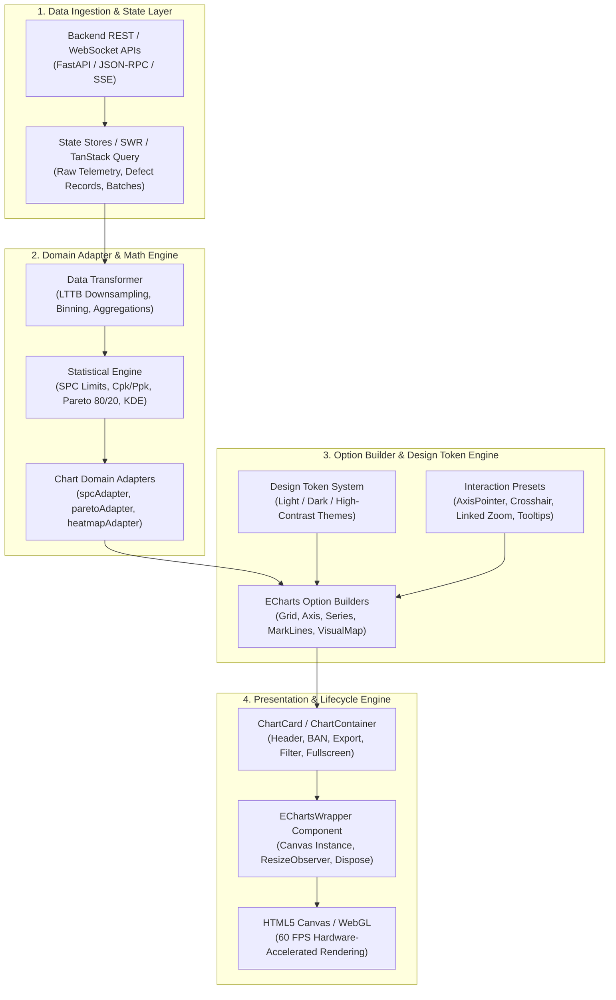
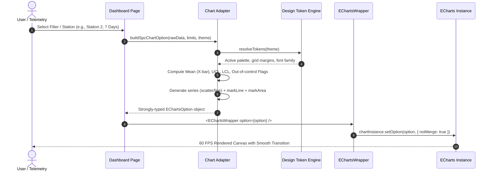

# Enterprise Visual Analytics 2026: Graphic System Architecture

This document specifies the technical architecture, component hierarchy, data contracts, and lifecycle protocols for the **Enterprise Visual Analytics & Graphic System**. It serves as the engineering blueprint for unified visualization across Main Dashboard, Quality Monitoring Board, Defect Analytics, and Production KPI pages.

---

## 1. High-Level System Architecture

The graphic system follows a **strict 4-tier decoupled architecture** separating domain data ingestion, mathematical/statistical transformation, visual option generation, and reactive canvas rendering.



---

## 2. Component Hierarchy & Architectural Responsibilities

The visualization system avoids monolithic chart components by partitioning responsibilities into three distinct levels:

```
src/components/analytics/
├── core/
│   ├── echartsCore.ts           # Modular tree-shaken ECharts bundle (Canvas + essential series/components)
│   ├── EChartsWrapper.tsx       # Universal ECharts lifecycle manager (zero business logic, self-contained resize)
│   ├── ChartContainer.tsx       # Standard card shell with title, KPI summary, and action bar
│   ├── chartTheme.ts            # ECharts theme registration for Light & Dark modes
│   └── chartTokens.ts           # Centralized visual design tokens (colors, radii, typography)
├── adapters/
│   ├── spcAdapter.ts            # Raw samples -> ECharts SPC option with UCL/LCL markLines and Nelson rules
│   ├── paretoAdapter.ts         # Defect counts/COPQ -> Sorted bar + cumulative percentage dual-axis
│   ├── capabilityAdapter.ts     # Measurements -> Histogram bins + Gaussian normal curve + USL/LSL
│   ├── heatmapAdapter.ts        # Line/Station matrix -> ECharts 2D visualMap heatmap
│   ├── bulletAdapter.ts         # Current, Target, Benchmark -> Bullet chart option
│   └── comboTrendAdapter.ts     # Time series -> Volume bar + PPM line dual-axis
├── specialized/
│   ├── SpcControlChart.tsx      # Domain wrapper binding spcAdapter to EChartsWrapper
│   ├── ParetoChart8020.tsx      # Domain wrapper binding paretoAdapter to EChartsWrapper
│   ├── CapabilityHistogram.tsx  # Domain wrapper binding capabilityAdapter
│   ├── DefectHeatmap.tsx        # Domain wrapper binding heatmapAdapter
│   └── KpiBulletChart.tsx       # Domain wrapper binding bulletAdapter
└── utils/
    ├── statisticalMath.ts       # Pure TypeScript math engine (SPC limits, Nelson rules 1–4, Cp/Cpk, Pp/Ppk)
    └── chartExport.ts           # PNG/SVG canvas capture and CSV dataset serialization
```

### 2.1 ECharts Modular Tree-Shaking (`echartsCore.ts`)
To prevent loading the uncompressed ~2.8MB monolithic ECharts library, the application imports only required renderers and series:

```typescript
// src/components/analytics/core/echartsCore.ts
import * as echarts from 'echarts/core';
import {
  LineChart,
  BarChart,
  HeatmapChart,
  SankeyChart,
  TreemapChart,
  BoxplotChart,
  ScatterChart,
  RadarChart,
  GaugeChart
} from 'echarts/charts';
import {
  GridComponent,
  TooltipComponent,
  LegendComponent,
  MarkLineComponent,
  MarkAreaComponent,
  VisualMapComponent,
  DataZoomComponent,
  BrushComponent,
  TitleComponent,
  CalendarComponent,
  DatasetComponent
} from 'echarts/components';
import { CanvasRenderer } from 'echarts/renderers';

echarts.use([
  CanvasRenderer,
  LineChart,
  BarChart,
  HeatmapChart,
  SankeyChart,
  TreemapChart,
  BoxplotChart,
  ScatterChart,
  RadarChart,
  GaugeChart,
  GridComponent,
  TooltipComponent,
  LegendComponent,
  MarkLineComponent,
  MarkAreaComponent,
  VisualMapComponent,
  DataZoomComponent,
  BrushComponent,
  TitleComponent,
  CalendarComponent,
  DatasetComponent
]);

export default echarts;
```
*Result: Reduces final gzipped bundle size from ~630KB to under 180KB.*

### 2.2 Responsibility Matrix

| Component | Responsibility | Allowed Dependencies | Prohibited Behaviors |
| :--- | :--- | :--- | :--- |
| **`EChartsWrapper`** | Native instance creation, canvas attachment, `resize()` handling, DOM unmount cleanup (`dispose`), SSR/error fallback. | `echarts/core`, React hooks | Fetching data, computing business formulas, hardcoded colors. |
| **`ChartContainer`** | Executive banner, BAN badge, timeframe selectors, fullscreen toggle, PNG/CSV export trigger. | Tailwind CSS, Lucide Icons, UI components | ECharts direct API calls. |
| **`Adapters`** | Pure functions that transform raw business data into valid, strongly-typed `EChartsCoreOption`. | Statistical helpers, design tokens | React state, DOM elements, window object. |
| **`Specialized Wrappers`** | Connecting domain props (`data`, `target`, `limits`) to the corresponding adapter and embedding within `ChartContainer`. | Adapter, `EChartsWrapper`, `ChartContainer` | Raw canvas manipulation. |

---

## 3. Data Flow Architecture

The data pipeline guarantees predictable state transitions from raw backend telemetry to the final canvas frame:



### 3.1 Structural Updates vs. Real-Time Streaming Protocol
The update mechanism must distinguish between two fundamentally different update frequencies:

1. **Structural / Dimension Changes (Filter, Station Swap, Timeframe Shift):**
   - Must use `chartInstance.setOption(option, { notMerge: true })`.
   - *Rationale:* Leaving `notMerge: false` (default) merges old series into new series, resulting in phantom markLines, duplicated axes, and stale tooltips from prior views.

2. **Real-Time Telemetry Streaming (1–5 Hz IoT / Sensor Updates):**
   - Must use `chartInstance.setOption({ series: [...] }, { notMerge: false, lazyUpdate: true })` or circular buffer slices.
   - *Rationale:* Forcing `notMerge: true` on every live incoming tick destroys DOM canvas render-states, resets zoom state, cancels running transition curves, and incurs heavy garbage collection.
   - Disable animations during live telemetry: `animationDurationUpdate: 250` or `animation: false` when streaming rate $> 2\text{ Hz}$.

---

## 4. Unified Theme System & Design Token Integration

All charts strictly inherit visual attributes from the centralized design token system, supporting seamless real-time switching between **Light**, **Dark (Slate/Navy)**, and **Industrial High-Contrast** modes without reloading.

### 4.1. Color Palette Tokens

```typescript
export const CHART_THEME_TOKENS = {
  light: {
    background: '#FFFFFF',
    surface: '#F8FAFC',
    border: '#E2E8F0',
    textPrimary: '#0F172A',
    textSecondary: '#64748B',
    textMuted: '#94A3B8',
    gridLine: '#F1F5F9',
    axisLine: '#CBD5E1',
    palette: [
      '#2563EB', // Blue 600 (Primary Metric)
      '#059669', // Emerald 600 (Good / In-Spec)
      '#D97706', // Amber 600 (Warning / Drift)
      '#DC2626', // Red 600 (Defect / Violation)
      '#7C3AED', // Violet 600 (Secondary Metric)
      '#0891B2', // Cyan 600 (Telemetry)
    ],
    spc: {
      centerLine: '#059669',
      controlLimit: '#DC2626',
      specLimit: '#9333EA',
      zoneSigma1: 'rgba(5, 150, 105, 0.08)',
      zoneSigma2: 'rgba(217, 119, 6, 0.08)',
      zoneSigma3: 'rgba(220, 38, 38, 0.08)',
      anomalyPoint: '#EF4444',
      normalPoint: '#2563EB',
    }
  },
  dark: {
    background: '#0B0F17',
    surface: '#121826',
    border: '#1E293B',
    textPrimary: '#F8FAFC',
    textSecondary: '#94A3B8',
    textMuted: '#64748B',
    gridLine: 'rgba(255, 255, 255, 0.06)',
    axisLine: 'rgba(255, 255, 255, 0.12)',
    palette: [
      '#3B82F6', // Blue 500
      '#10B981', // Emerald 500
      '#F59E0B', // Amber 500
      '#EF4444', // Red 500
      '#8B5CF6', // Violet 500
      '#06B6D4', // Cyan 500
    ],
    spc: {
      centerLine: '#10B981',
      controlLimit: '#EF4444',
      specLimit: '#A855F7',
      zoneSigma1: 'rgba(16, 185, 129, 0.12)',
      zoneSigma2: 'rgba(245, 158, 11, 0.12)',
      zoneSigma3: 'rgba(239, 68, 68, 0.12)',
      anomalyPoint: '#F87171',
      normalPoint: '#60A5FA',
    }
  }
};
```

### 4.2. Universal Tooltip & Axis Typography Contract
- **Font Family:** `Inter, -apple-system, BlinkMacSystemFont, "Segoe UI", Roboto, sans-serif`
- **Axis Label Size:** `11px` (Muted contrast, never bold)
- **Tooltip Container:** Rounded 8px, backdrop blur 8px, 1px subtle border, deep elevation shadow `0 10px 15px -3px rgba(0, 0, 0, 0.3)`
- **Crosshair (`axisPointer`):** Crisp dashed line (`rgba(148, 163, 184, 0.4)`), zero obstruction of active data markers.

---

## 5. Memory Management & Performance Protocol

Real-time manufacturing dashboards frequently update at 1–5 Hz. Without strict lifecycle management, browser tabs leak memory and freeze within hours. The following four-tier protocol is mandatory:

### 5.1. The Zero-Leak Lifecycle Contract
Every ECharts instance **must** register an unmount cleanup routine:

```typescript
useEffect(() => {
  if (!chartRef.current) return;

  const instance = echarts.init(chartRef.current, theme, {
    renderer: 'canvas', // Hardware accelerated
    useDirtyRect: true,  // Optimize redraw by only repainting dirty rectangles
  });

  // Handle Resize via ResizeObserver with 150ms debounce
  const resizeObserver = new ResizeObserver(
    debounce(() => {
      if (instance && !instance.isDisposed()) {
        instance.resize({ animation: { duration: 250, easing: 'cubicOut' } });
      }
    }, 150)
  );
  resizeObserver.observe(chartRef.current);

  return () => {
    resizeObserver.disconnect();
    if (instance && !instance.isDisposed()) {
      instance.dispose(); // CRITICAL: Frees WebGL contexts and canvas memory
    }
  };
}, [theme]);
```

### 5.2. Large Dataset Rendering Guardrails (LTTB Downsampling)
When plotting sensor feeds or high-density batch inspection data ($N > 2,000$ points):
1. **Downsampling Strategy:** Set `series.sampling: 'lttb'` (Largest-Triangle-Three-Buckets). This preserves visual peaks, valleys, and anomalies while reducing rendering vertices by 90%.
2. **Progressive Rendering:** Enable `series.progressive: 2000` to stream rendering across multiple frames, guaranteeing the UI thread never drops below 60 FPS.
3. **Canvas vs. SVG:**
   - **Canvas (`renderer: 'canvas'`):** Default for all monitoring, time-series, and heatmap charts ($N > 500$ elements).
   - **SVG (`renderer: 'svg'`):** Reserved strictly for static report printing, tiny sparklines, or single-value radial gauges ($N < 50$).

---

## 6. Adapter Pattern Specification

Adapters are pure TypeScript modules with **zero side effects**. They isolate business data schemas from charting libraries.

### Standard Adapter Signature
```typescript
export interface BaseChartAdapterInput<TData, TOptions = Record<string, unknown>> {
  data: TData;
  theme: 'light' | 'dark';
  options?: TOptions;
}

export type ChartOptionBuilder<TData, TOptions = Record<string, unknown>> = (
  input: BaseChartAdapterInput<TData, TOptions>
) => echarts.EChartsCoreOption;
```

### Concrete Implementation: `spcAdapter.ts`
```typescript
export function buildSpcOption(input: {
  samples: Array<{ timestamp: string; value: number }>;
  mean: number;
  ucl: number;
  lcl: number;
  usl?: number;
  lsl?: number;
  theme: 'light' | 'dark';
}): echarts.EChartsCoreOption {
  const tokens = CHART_THEME_TOKENS[input.theme];
  
  return {
    grid: { top: 40, right: 30, bottom: 40, left: 50, containLabel: true },
    tooltip: { trigger: 'axis', axisPointer: { type: 'cross' } },
    xAxis: {
      type: 'category',
      data: input.samples.map(s => s.timestamp),
      axisLine: { lineStyle: { color: tokens.axisLine } },
    },
    yAxis: {
      type: 'value',
      scale: true, // Auto-zoom around control limits
      splitLine: { lineStyle: { color: tokens.gridLine } },
    },
    series: [
      {
        name: 'Measurement',
        type: 'line',
        data: input.samples.map(s => s.value),
        smooth: false,
        sampling: 'lttb',
        itemStyle: {
          color: (params) => {
            const val = params.value as number;
            return (val > input.ucl || val < input.lcl) ? tokens.spc.anomalyPoint : tokens.spc.normalPoint;
          }
        },
        markLine: {
          symbol: 'none',
          data: [
            { yAxis: input.ucl, name: 'UCL', lineStyle: { color: tokens.spc.controlLimit, type: 'dashed' } },
            { yAxis: input.mean, name: 'CL', lineStyle: { color: tokens.spc.centerLine, type: 'solid' } },
            { yAxis: input.lcl, name: 'LCL', lineStyle: { color: tokens.spc.controlLimit, type: 'dashed' } },
          ]
        }
      }
    ]
  };
}
```

---

## 7. Extensibility Guidelines for Future AI Coding Agents

When adding a new chart archetype to the system, follow this mandatory 4-step checklist:

1. **Step 1 (Schema & Math):** Define the TypeScript input interface in `src/types/analytics.ts`. If the chart requires statistics (e.g., standard deviation, bin width, percentiles), place calculations in `src/utils/statisticalMath.ts` accompanied by unit tests.
2. **Step 2 (Pure Adapter):** Implement the adapter function in `src/components/analytics/adapters/[name]Adapter.ts`. Ensure it receives `theme` and never hardcodes hex codes.
3. **Step 3 (Specialized Component):** Create `src/components/analytics/specialized/[Name]Chart.tsx`. Wrap with `ChartContainer` to provide standard header, BAN, and export capabilities.
4. **Step 4 (Verification):**
   - Run `pnpm build` to verify zero TypeScript errors.
   - Verify both Light and Dark mode rendering.
   - Verify smooth window resize behavior without clipped legends or overlapping axis tick labels.
