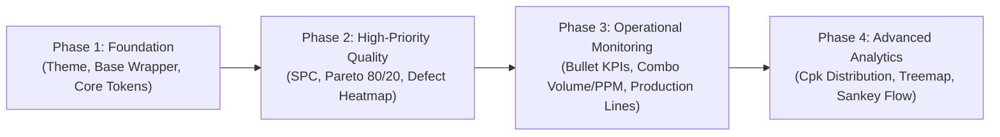
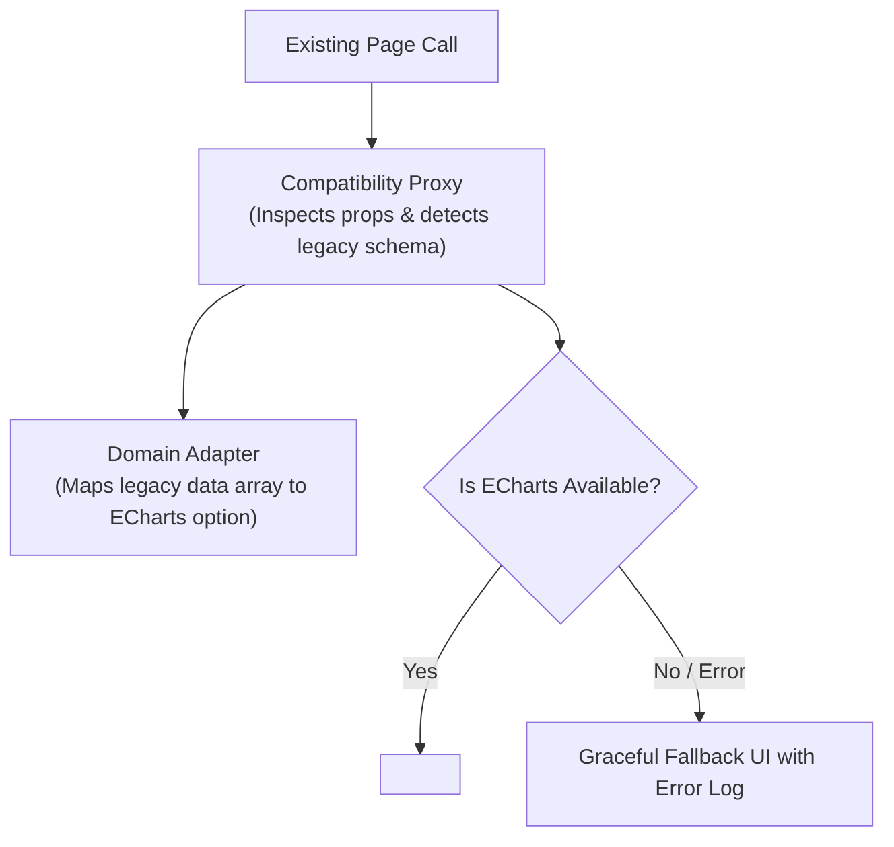

# Enterprise Visual Analytics 2026: Implementation Roadmap & Governance

This document establishes the execution sequence, priority rankings, migration protocol, quality assurance criteria, and non-negotiable governance principles for implementing the **Enterprise Visual Analytics & Graphic System** across the application suite.

---

## 1. Phased Implementation Plan

The rollout is divided into four incremental, value-driven phases. Each phase builds on verified architectural foundations to ensure zero regression in production monitoring.



### Phase 1: Core Foundation & Lifecycle Infrastructure
*Objective: Establish zero-leak rendering wrapper, design token integration, and responsive layout management.*
- [x] Create centralized theme tokens (`chartTokens.ts`) supporting Light, Dark, and Industrial High-Contrast.
- [x] Register ECharts custom theme definitions (`chartTheme.ts`).
- [x] Implement memory-safe `EChartsWrapper.tsx` with automatic canvas resize and unmount disposal.
- [x] Implement standard `ChartContainer.tsx` shell providing consistent header, BAN, filter, and export actions.
- [x] Establish error boundary handling to isolate chart crashes from page-level downtime.

### Phase 2: High-Priority Quality & SPC Visualizations
*Objective: Deliver core shop-floor quality inspection, COPQ triage, and statistical process control capabilities.*
- [ ] **Step 0 – Pure Statistical Math Engine (`src/utils/statisticalMath.ts`):**
  - Implement and unit-test I-MR limits ($UCL = \bar{X} \pm 2.66\overline{MR}$, $UCL_{MR} = 3.267\overline{MR}$).
  - Implement X-bar & R factors table ($n = 3 \text{ to } 5$: $A_2, D_3, D_4$).
  - Implement Western Electric / Nelson Rules 1–4 automated violation evaluator.
  - Implement $C_p / C_{pk}$ (using within-subgroup $\hat{\sigma} = \overline{MR}/1.128$ or $\bar{R}/d_2$) and $P_p / P_{pk}$ (using total sample $s$).
- [ ] **Shewhart Control Chart (I-MR / X-bar & R):** Dual-grid sensor feed with auto-computed $\bar{X}$, $UCL$, $LCL$, $UCL_{MR}$ and Nelson rule violation badges.
- [ ] **Pareto 80/20 Dual-Axis Chart (COPQ & Frequency):** Defect frequency and scrap cost sorting with cumulative percentage curve and 80% reference markLine.
- [ ] **Line-Station Defect Matrix Heatmap:** 2D grid correlating manufacturing lines against inspection stations with continuous visualMap to pinpoint localized yield loss.
- [ ] Integrate into **Quality Monitoring Board** and **Defect Analytics** views.

### Phase 3: Operational Monitoring & Performance Visualizations
*Objective: Replace generic operational gauges and bars with high-density, context-rich comparative graphics.*
- [ ] **Micro-Metric Bullet Cards:** Multi-range bands (Poor, Acceptable, Good) with target markers replacing static progress bars.
- [ ] **Production vs. PPM Combo Trend Chart:** Synchronized dual-axis time-series correlating daily output volume with defect PPM.
- [ ] **Shift / Line Status Small Multiples:** Grid of sparklines comparing Line 1 through Line 5 yield trends side-by-side.
- [ ] Integrate into **Main Dashboard** and **Production Monitoring** pages.

### Phase 4: Advanced Analytical & Statistical Visualizations
*Objective: Provide deep-dive process capability, material lineage, and defect taxonomy analysis.*
- [ ] **Process Capability Histogram (Cp/Cpk):** Normal Gaussian curve overlay with $USL$, $LSL$, and capability index calculation.
- [ ] **Hierarchical Defect Treemap:** Nested drill-down from Defect Category $\rightarrow$ Defect Type $\rightarrow$ Sub-assembly.
- [ ] **Material-to-Yield Sankey Diagram:** Material lot allocation flow tracking yield progression through compounding, dipping, washing, and packaging.
- [ ] Integrate into **Quality Intelligence** and **Executive Review** dashboards.

---

## 2. Top 12 Priority Charts (Industrial Value vs. Implementation Complexity)

| Rank | Chart Archetype | Target Dashboard | Industrial / Business Value | Complexity | Target Phase |
| :---: | :--- | :--- | :--- | :---: | :---: |
| **1** | **Shewhart I-MR SPC Chart** | Quality Monitoring Board | **Critical:** Detects process drift before producing scrap. | Medium | Phase 2 |
| **2** | **Pareto 80/20 Analysis** | Defect Analytics | **Critical:** Directs engineering focus to the vital 20% root causes. | Low | Phase 2 |
| **3** | **Production & PPM Combo Trend** | Main Executive Dashboard | **High:** Correlates production speed with quality degradation. | Low | Phase 3 |
| **4** | **Micro-Metric Bullet Chart** | KPI Summary Bar | **High:** Replaces misleading gauges with compact contextual targets. | Low | Phase 3 |
| **5** | **Line × Station Defect Heatmap** | Production Monitoring | **High:** Instant spatial recognition of equipment anomalies. | Medium | Phase 2 |
| **6** | **Process Capability (Cpk) Histogram** | Quality Intelligence | **High:** Validates if process can reliably meet customer specs. | Medium | Phase 4 |
| **7** | **Shift Yield Small Multiples** | Shift Handoff / Monitoring | **Medium:** Side-by-side comparison across operators/shifts. | Low | Phase 3 |
| **8** | **Defect Root Cause Treemap** | Defect Analytics | **Medium:** Proportional visualization of defect sub-categories. | Medium | Phase 4 |
| **9** | **Cost of Poor Quality Waterfall** | Executive Financial Review | **Medium:** Bridges engineering scrap counts with financial P&L. | Medium | Phase 3 |
| **10** | **Process Flow Sankey Diagram** | Material Traceability | **Medium:** Visualizes scrap loss at each transformation step. | High | Phase 4 |
| **11** | **Inspection Correlation Scatter** | Lab / Metrology Analytics | **Medium:** Identifies sensor cross-talk and calibration drift. | Medium | Phase 4 |
| **12** | **OEE Multi-Ring Radial Gauge** | Machine Cell Station | **Low-Medium:** Visualizes Availability $\times$ Performance $\times$ Quality. | Low | Phase 3 |

---

## 3. Migration Strategy for Legacy Visualizations

To guarantee zero production disruption, legacy chart components must be migrated using an **In-Place Adapter Proxy Pattern**:



1. **Step 1 – Compatibility Wrapper:** Create a replacement component with identical prop signatures to the legacy chart.
2. **Step 2 – Transparent Transformation:** The wrapper invokes the pure domain adapter to translate legacy data structures into `EChartsCoreOption`.
3. **Step 3 – Dual Verification:** Run side-by-side visual tests ensuring data values, labels, and tooltips match exactly.
4. **Step 4 – Deprecation & Cleanup:** Once verified across all host views, update call sites to use the specialized ECharts component directly and remove legacy code.

---

## 4. QA Verification Checklist & Performance Budgets

Every chart implementation must pass all five verification gates prior to deployment:

```markdown
### Visual & Data Accuracy Gate
- [ ] Data points render at correct pixel coordinates without truncation.
- [ ] Secondary axis scale aligns accurately with secondary series (e.g., cumulative % reaches 100% on the right spine).
- [ ] Zero values are visually distinct from null/missing data points (nulls break lines; zeros drop to baseline).
- [ ] SPC control limits ($UCL$, $LCL$) are visually distinguished from specification limits ($USL$, $LSL$).

### Responsive & Layout Gate
- [ ] Chart redraws cleanly within 150ms of container resize without text overlapping.
- [ ] Axis labels rotate or alternate automatically on narrow viewport widths (<640px).
- [ ] Long category names truncate with ellipsis (`...`) and reveal full text on tooltip hover.

### Theme & Contrast Gate
- [ ] All text passes WCAG AA contrast (minimum 4.5:1 against card surface).
- [ ] Gridlines remain subtle and subordinate in both Light and Dark themes.
- [ ] Theme switching occurs smoothly without canvas flash or unmounted instance errors.

### Performance & Memory Budget
- [ ] **Frame Budget:** Maintains 60 FPS during zooming, panning, and crosshair movement.
- [ ] **Render Budget:** Initial canvas paint completes in under **300ms** for datasets up to 5,000 points.
- [ ] **Memory Invariant:** Memory usage returns to baseline upon component unmount (`instance.dispose()` verified in DevTools heap snapshot).

### Interaction & Accessibility Gate
- [ ] Crosshair pointer does not obstruct the active data point marker.
- [ ] Tooltip positions defensively to remain within viewport boundaries.
- [ ] Canvas element contains descriptive `aria-label` summarizing current metric and trend.
```

---

## 5. Ten Non-Negotiable Design Principles for AI Agents

Every future AI coding agent modifying or creating visualizations in this repository **must strictly adhere to these ten rules**:

1. **Rule 1 – Never Invent Ad-hoc Colors:** All series, grid, axis, and text colors must be derived exclusively from `CHART_THEME_TOKENS`. Never insert raw hex codes into component files.
2. **Rule 2 – Never Omit Clean Disposal:** Every ECharts instance must be coupled to an unmount cleanup routine calling `instance.dispose()`. Stale instances will be rejected during PR review.
3. **Rule 3 – Decouple Math from Rendering:** Statistical logic (averages, standard deviations, control limits, binning) must reside in pure testable utility functions, never inline within React render bodies.
4. **Rule 4 – Strict Statistical Truth (AIAG/ISO Compliance):** Never confuse control limits ($UCL = \bar{X} \pm 3\sigma$) with specification limits ($USL, LSL$), and never label a desired business target as an SPC limit. For capability analysis, calculate $C_p/C_{pk}$ using within-subgroup variation ($\overline{MR}/1.128$ or $\bar{R}/d_2$), and reserve total sample standard deviation $s$ for $P_p/P_{pk}$.
5. **Rule 5 – BAN Anchor Requirement:** Every primary dashboard chart card must feature a Big Angled Number (BAN) in its header displaying current value, unit, and delta vs. benchmark.
6. **Rule 6 – Zero-Obscuration Crosshairs:** Crosshairs and tooltips must never cover the exact data vertex being inspected. Use subtle dashed pointers with offset tooltips.
7. **Rule 7 – Update Lifecycle Discipline:** Use `{ notMerge: true }` when switching filters, stations, or metric schemas to prevent phantom artifacts. Use `{ notMerge: false, lazyUpdate: true }` with buffer slicing for high-frequency live telemetry streaming.
8. **Rule 8 – Downsample Large Datasets:** Any time-series exceeding 2,000 points must employ LTTB downsampling (`series.sampling: 'lttb'`) to safeguard the browser thread.
9. **Rule 9 – Preserve Industrial Data Density:** Avoid sparse, decorative mobile-style charts. Maximize data-ink ratio with clean typography, compact margins, and dual visual encodings.
10. **Rule 10 – Respect the Industrial Environment:** Avoid heavy glassmorphism, glowing neons, or transparent data tables on operational monitoring boards. Clear, high-contrast readability under factory lighting takes precedence over decorative aesthetics.
